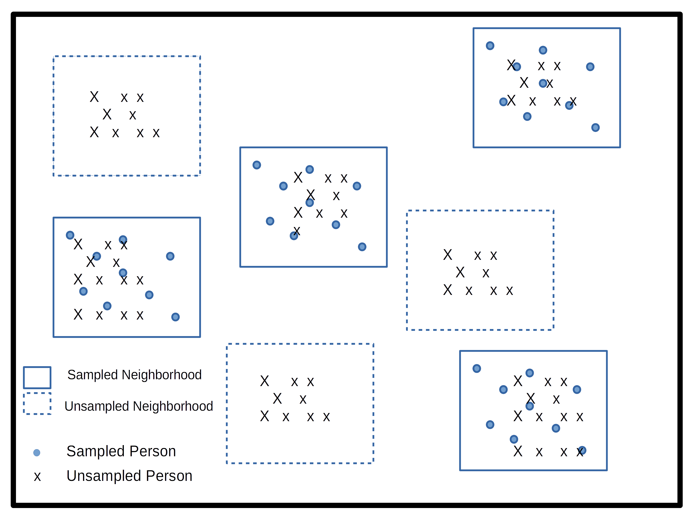

## Introduction

Most of what demographers know about health, work, migration and family life comes from surveys, and almost none of those surveys are simple random samples. They stratify, they cluster, they oversample small groups, and then they adjust the weights so the sample lines up with census totals. Every one of those choices changes how we should estimate a mean, a proportion or a regression coefficient, and how much uncertainty we should attach to it. If we ignore the design, the software will still give us numbers. They will just describe the sample and not the population, and the standard errors will usually be too small.

This week I walk through the logic of survey weights and design variables, then use the 2024 BRFSS SMART MMSA data to show what changes, and what doesn't, when we take the design seriously. The last part covers replicate weights, which is how many federal surveys (the American Community Survey among them) ship their design information. Everything we do later in the semester (logit models, count models, multilevel models) builds on the design object you make this week.

## Setup

The `survey` package does the heavy lifting [@lumley2010]. `srvyr` lets us use it inside `dplyr` pipelines, `gtsummary` and `modelsummary` make tables, and `tidycensus` and `ipumsr` read ACS microdata with replicate weights.

```{r}
#| label: packages
library(tidyverse)
library(here)
library(survey)
library(srvyr)
library(gtsummary)
library(modelsummary)
library(tidycensus)
library(ipumsr)
library(sparkscolors)  # pak::pak("coreysparks/sparkscolors"), UTSA colors

source(here("R", "get_mmsa.R"))
source(here("R", "get_dhs_model.R"))
```

```{r}
#| label: setup
#| include: false
theme_set(
  theme_minimal(base_size = 12) +
    theme(text = element_text(colour = utsa_cols("midnight")),
          panel.grid.major = element_line(colour = utsa_cols("smoke")),
          panel.grid.minor = element_blank(),
          legend.position = "bottom")
)
fmt <- function(x, d = 0) format(round(x, d), big.mark = ",", nsmall = d)
pct <- function(x, d = 1) paste0(format(round(100 * x, d), nsmall = d), "%")
```

## Why survey design matters

### Where demographic data come from

Most demographic research rests on three kinds of data. First are censuses and other population enumerations, which national statistical agencies carry out and demographers use once they're released. Second are vital registration data on births and deaths, which are also collected by government agencies, who oversee their collection and quality. Third are surveys, and surveys can come from almost anywhere. It's not uncommon for us to collect our own survey data for a project, usually on a specialized population we want to learn about. But surveys can also be very general, like the BRFSS, the American Community Survey or the DHS, and because there are so many large and small survey efforts, survey data exist on many topics, places and time periods.

Demographers are usually interested in population-level conclusions, so the surveys we use have to be collected with a lot of attention paid to making the sample represent the **target population** we're trying to describe. That attention is what produces the design features this week is about.

### What to ask of any survey

A survey is a systematic method for gathering information from a sample of entities, for the purpose of constructing quantitative descriptors of the attributes of the larger population of which the entities are members. When you pick up a new survey data source, these are the first questions to answer:

1. What is the target population?
2. What is the sampling frame? In other words, how do we know who *could* have been included?
3. What is the sample design?
4. What is the mode of data collection (in person, telephone, web, mail)?
5. Is the survey ongoing, or a one-time collection?

For the BRFSS, the answers are: non-institutionalized adults 18 and older; landline and cell phone numbers; a stratified random sample of telephone numbers within each state; telephone interviews (with a growing web component in some states); and an ongoing annual survey that has run since 1984.

Data collected with public funds generally have to be made available to the public along with information on how to use them, and surveys from reputable sources (federal agencies, or archives like ICPSR at the University of Michigan) come with a codebook or user's guide describing when, where and how the data were collected. I cannot stress enough that learning how your survey was designed, and how its designers say to use the design variables, is the first job in any analysis. The manual will tell you the names of the stratum, cluster and weight variables, and it will often tell you which weight to use for which purpose. Read it.

### Some vocabulary

A few terms come up over and over, and it's worth pinning them down before we touch any data. @lohr2019 is my go-to reference for the theory here, and @lumley2010 for how to do it in R.

The **target population** is the group the survey is designed to describe. For the BRFSS it is non-institutionalized adults living in households with a telephone. The DHS has traditionally targeted women of reproductive age and their young children living in households (the modern DHS also interviews men and couples). The **observational units** are the level at which data are collected, usually a person or a household. The **sampling frame** is the list we actually draw from, which for a telephone survey is the set of landline and cell phone numbers, and for a household survey is often the most recent census. The **sampling units** are what gets selected at each stage. We may not have a list of every school-age child, for example, but we may have a list of schools, so we sample schools and then children within them.

**Strata** are relatively homogeneous groups the frame is split into before sampling, and the survey samples independently within each one. In the DHS the strata are usually the urban and rural parts of each region. Stratifying usually makes estimates more precise, because it guarantees the sample covers each stratum. **Clusters** do the opposite. Within each stratum, the DHS selects clusters, which are neighborhoods in cities and villages or small towns in rural areas, and then households within each selected cluster. That's a **two-stage design**, and the first-stage units are called **primary sampling units**, or PSUs. A school district study might go further, sampling schools, then classrooms within schools, then students, for a three-stage design.

{width=60%}

The trouble with clusters is that the people within one are not independent of one another. People in the same village or the same school tend to resemble one another, so 20 people from one village carry less information than 20 people from 20 villages, and clustering usually makes estimates less precise. Nearly every statistical method you learned in the first course assumes independent observations, and a clustered sample violates that assumption by design. Clustering also tends to produce errors that aren't homoskedastic. So the design has to go into the analysis.

### What a weight is

If person $i$ had a probability $\pi_i$ of being selected, their base weight is

$$
w_i = \frac{1}{\pi_i}
$$

which is the number of people in the population that person stands in for. The $\pi_i$ is the **inclusion probability**, and knowing it requires knowing the population. If we stratified the U.S. by rural and urban residence, we'd need to know how many people live in each to know the chance that any one of them is sampled. The more complicated the design, the more complicated the calculation.

Surveys then adjust these base weights for nonresponse and rake or post-stratify them so that weighted totals match known population counts by age, sex, race and ethnicity, and so on. The BRFSS does all of this [@cdc2020; @cdc_smart2024]. Its design weight combines the stratum weight (which depends on the number of records sampled in a stratum and the density of phone lines there), the number of phones in the household, and the number of adults in the household. That design weight is then **raked**, adjusted iteratively until the weighted sample matches population margins for age, sex, race and ethnicity, education, marital status, home ownership, phone ownership, and several combinations of these. After all that, a respondent's weight is interpretable as the number of adults they represent. If your weight is 100, you stand in for 100 people.

#### He's not heavy, he's my brother

The question I get every semester is "Do I really need to weight my analysis?" and of course I say, "Of course!" Weights don't just inflate your sample up to the size of the population. They correct for the ways the sample differs from the population, and those differences come from three places:

1. **Unequal probabilities of selection.** Some designs give some people a higher chance of selection on purpose. Many surveys **oversample** small groups so they have enough respondents to say something about them. If recent refugees are 0.1% of a population, a study of refugees might make them 10% of its sample, and the weights then shrink each refugee respondent back down to their share of the population. Add Health, for example, oversampled Black adolescents with college-educated parents, as well as Cuban, Puerto Rican, Chinese and physically disabled adolescents.
2. **Differences in response rates across groups.** Some people are harder to reach or less willing to participate, and nonresponse bias can badly distort population estimates if key groups respond at low rates.
3. **Differences between the sample and the population** that remain after the first two adjustments, which raking and post-stratification fix.

Some surveys are designed to be **self-weighting**, meaning every unit has the same chance of selection and no weights are needed (or provided). Again, the documentation for your survey tells you which situation you're in.

With unweighted data, every case counts equally, and the results describe only the people who happened to answer. With weighted data, each case counts in proportion to how many people it represents, and the results describe the target population.

Here is the simplest possible example: five people, with weights.

```{r}
#| label: toy-weights
toy <- tibble(y = c(4, 2, 1, 5, 2),
              weight = c(1, 2, 4, 1, 2))
toy

toy |>
  summarise(unweighted_mean = mean(y),
            weighted_mean = weighted.mean(y, w = weight))
```

The person with `y = 1` has a weight of 4, so they count four times as much as the person with `y = 4`, and the weighted mean is pulled down. That's all a weight does to a point estimate. The harder part, and the part that takes special software, is getting the standard error right.

## The BRFSS SMART MMSA design

### Reading the data

`get_mmsa()` reads the 2024 file and cleans up the names (see the week 1 materials). Keep the [calculated variables codebook](https://www.cdc.gov/brfss/annual_data/2024/pdf/2024-calculated-variables-version4-508.pdf) and the [variable layout](https://www.cdc.gov/brfss/annual_data/2024/pdf/MMSA_VarLayout_24-508.pdf) open while you work.

```{r}
#| label: load-brfss
brfss <- get_mmsa(2024)
```

### Finding the design variables

Every survey documents its design variables somewhere, and finding them is always the first job. For the MMSA file there are two: the stratum, `_STSTR` (`ststr` after cleaning), and the MMSA final weight, `_MMSAWT` (`mmsawt`). The MMSA weight is calibrated to each metro area's adult population, so it is the right weight for metro-level estimates. Don't use the state weight from the full BRFSS file with these data.

You might go looking for a cluster variable and not find one. The state BRFSS files include `_PSU`, but it is just the respondent's sequence number. The BRFSS samples telephone numbers, not neighborhoods, so each respondent is their own PSU. In `survey` notation that is `ids = ~1`.

Writing `ids = ~seqno` should be equivalent, but it shows a common error.

```{r}
#| label: nest-error
#| error: true
options(survey.lonely.psu = "adjust")

svydesign(ids = ~seqno, strata = ~ststr, weights = ~mmsawt, data = brfss)
```

Sequence numbers start over in every state, so the same `seqno` shows up in more than one stratum. `nest = TRUE` tells `survey` that PSU labels are only unique within strata. Many surveys number their PSUs this way, and you will see this error again.

```{r}
#| label: nest-fix
any(duplicated(brfss$seqno))

des_nest <- svydesign(ids = ~seqno, strata = ~ststr, weights = ~mmsawt,
                      data = brfss, nest = TRUE)
```

The `survey.lonely.psu` option deals with a different problem. A stratum with only one PSU has no within-stratum variance to estimate. The file has `r sum(table(brfss$ststr) == 1)` strata with a single respondent. Setting the option to `"adjust"` centers those strata at the overall mean rather than the stratum mean, which is conservative. `"average"` instead replaces the variance contribution of those strata with the average contribution of all the others. See `?surveyoptions` for the rest.

In general, there are three things to find in any survey codebook: the stratum identifier, the PSU (or cluster) identifier, and the respondent weight. Your survey may not have all three, and it may have several weights for different purposes. And be aware that the menu of statistical methods is shorter for complex survey data than for simple random samples. Some analyses you'd like to do *may not be available* with full design-based inference, and I'll point out those gaps as we hit them this semester.

### Recoding

Now the recodes. Missing value codes (7 for "don't know", 9 for "refused") differ from variable to variable, so check the codebook every time. Here I use the calculated education and age variables, the three-group race and ethnicity measure `_RACEGR3`, and BMI, which is stored with two implied decimal places.

```{r}
#| label: recode
brfss <- brfss |>
  mutate(
    badhealth = case_when(genhlth %in% 4:5 ~ 1,
                          genhlth %in% 1:3 ~ 0),
    female = if_else(sexvar == 2, 1, 0),
    race_eth = factor(case_when(racegr3 == 1 ~ "NH White",
                                racegr3 == 2 ~ "NH Black",
                                racegr3 == 3 ~ "NH Other",
                                racegr3 == 4 ~ "NH Multiracial",
                                racegr3 == 5 ~ "Hispanic"),
                      levels = c("NH White", "NH Black", "NH Other",
                                 "NH Multiracial", "Hispanic")),
    educ = factor(case_when(educag == 1 ~ "Less than HS",
                            educag == 2 ~ "HS graduate",
                            educag == 3 ~ "Some college",
                            educag == 4 ~ "College graduate"),
                  levels = c("Less than HS", "HS graduate",
                             "Some college", "College graduate")),
    agec = factor(ageg, levels = 1:6,
                  labels = c("18-24", "25-34", "35-44", "45-54", "55-64", "65+")),
    bmi = bmi5 / 100,
    obese = if_else(bmi >= 30, 1, 0),
    texas = str_detect(mmsaname, ", TX"),
    place = str_remove(mmsaname, ", [A-Z]{2}(-[A-Z]{2})*, .*$")
  )
```

::: {.callout-note}
Notice that I recode the whole file and don't drop anyone yet. Respondents with missing values still carry design information, and when we want estimates for a subgroup, we'll tell the design about it (more on this below).
:::

## Three ways to analyze the same data

I'll use one question to compare approaches: how does the share of adults reporting fair or poor health differ by education?

### Ignoring the design

This is what you get from ordinary tables, which treat the data as a simple random sample.

```{r}
#| label: naive-table
naive_tab <- table(brfss$badhealth, brfss$educ)
round(100 * prop.table(naive_tab, margin = 2), 1)

chisq.test(naive_tab)
```

The gradient is strong: people with less education report worse health. But these are the proportions *in the sample*, and the test treats every respondent as an independent draw with equal probability of selection. Neither is true.

### Weights only

Weighting the table fixes the point estimates.

```{r}
#| label: weighted-table
wt_tab <- xtabs(mmsawt ~ badhealth + educ, data = brfss)
round(100 * prop.table(wt_tab, margin = 2), 1)
```

```{r}
#| label: age-shares
#| include: false
old_unwt <- mean(brfss$ageg == 6)
old_wt <- weighted.mean(brfss$ageg == 6, brfss$mmsawt)
```

The weighted prevalences are lower than the unweighted ones in every education group. The people who answer the BRFSS are, on average, in worse health than the adult population the weights describe. They're older, for one thing: `r pct(old_unwt)` of respondents are 65 or older, compared with `r pct(old_wt)` of the weighted population. The weights correct for that. This is the "bias" part of the argument for weighting, and it's why I won't accept unweighted descriptive statistics from survey data in your papers.

But what about standard errors? For a proportion, the textbook formula is $s.e.(p) = \sqrt{p(1-p)/n}$, so all we need is $p$ and $n$. The trouble is deciding what $n$ is. In a weighted table, the "count" in each cell is a number of *people in the population*, not respondents.

```{r}
#| label: weighted-se
wt_se <- as_tibble(wt_tab) |>
  group_by(educ) |>
  mutate(n_weighted = sum(n), p = n / n_weighted) |>
  filter(badhealth == 1) |>
  left_join(count(filter(brfss, !is.na(badhealth)), educ, name = "n_sample"),
            by = "educ") |>
  mutate(se_weighted_n = sqrt(p * (1 - p) / n_weighted),
         se_sample_n = sqrt(p * (1 - p) / n_sample))

wt_se |>
  select(educ, p, n_sample, n_weighted, se_weighted_n, se_sample_n) |>
  knitr::kable(digits = c(0, 3, 0, 0, 6, 4), format.args = list(big.mark = ","))
```

If we plug in the weighted $n$, we've basically inflated the sample to the adult population of these metro areas, and the standard errors are absurdly small (the fifth column). Plugging in the number of respondents is better, but that formula still assumes a simple random sample, and as we're about to see, it is still too small. Getting the right standard error is the other half of what survey software is for.

### The full design

Now we declare the design and let `survey` compute everything.

```{r}
#| label: design
des <- svydesign(ids = ~1, strata = ~ststr, weights = ~mmsawt, data = brfss)
des

svyby(~badhealth, ~educ, design = des, FUN = svymean, na.rm = TRUE)
```

The point estimates match the weighted table, and now each one comes with a standard error that reflects the design. The design-based test of independence is the Rao-Scott adjusted chi-square [@rao_scott1984], which `survey` reports as an F statistic.

```{r}
#| label: rao-scott
svychisq(~badhealth + educ, design = des)
```

### Comparing the standard errors

Standard errors from a survey measure how much an estimate would vary across the many possible samples the design could have drawn. They are what we use to test hypotheses and compare groups, and using inaccurate standard errors can lead us to call results statistically significant when they aren't, and occasionally the reverse. The usual formulas assume a simple random sample, and software built for simple random samples tends to underestimate the standard errors from complex designs, because it ignores the variation within and between clusters and the effect of unequal weights. There are basically three ways software estimates variances:

1. the **naive** method, which ignores the design;
2. **Taylor series linearization**, which `svydesign()` uses by default; and
3. **replication** (balanced repeated replication, the jackknife, or the bootstrap), which I come back to at the end of this document.

To see what each piece of the design does, I make two more design objects: one that pretends the data are a simple random sample, and one that uses the weights but ignores the strata.

```{r}
#| label: se-compare
des_srs <- svydesign(ids = ~1, weights = ~1, data = brfss)
des_wt  <- svydesign(ids = ~1, weights = ~mmsawt, data = brfss)

se_compare <- list("Simple random sample" = des_srs,
                   "Weights only" = des_wt,
                   "Weights and strata" = des) |>
  map(\(d) svyby(~badhealth, ~educ, design = d, FUN = svymean, na.rm = TRUE)) |>
  list_rbind(names_to = "design") |>
  as_tibble() |>
  mutate(design = fct_inorder(design))

se_compare |>
  select(design, educ, badhealth, se) |>
  pivot_wider(names_from = design, values_from = c(badhealth, se)) |>
  knitr::kable(digits = 4)
```

::: {.callout-note title="Code explanation: `map()` and `\\(d)`"}
There's a lot packed into that first pipe, so here it is one step at a time.

1. `list(...)` puts the three design objects in a named list. The names are what will label the rows later.
2. `map()`, from `purrr`, runs a function on each element of a list and returns a list of the results. Here it runs `svyby()` three times, once per design.
3. `\(d)` is how you write a function on the fly without naming it. It's shorthand for `function(d)` (added in R 4.1), so it's the same thing as writing `mymean()` in week 1, just without saving it. Each time through, `map()` hands the next design to the function, and inside the function that design is called `d`. The name is arbitrary; I used `d` for "design."
4. `list_rbind(names_to = "design")` stacks the three results into one data frame and adds a `design` column with the list names.
5. `fct_inorder(design)` makes `design` a factor in the order the designs appear, so tables and plots don't sort them alphabetically.

Without `map()`, you'd write the `svyby()` call three times, then label and bind the results yourself:

```r
bind_rows(
  svyby(~badhealth, ~educ, design = des_srs, FUN = svymean, na.rm = TRUE) |> mutate(design = "Simple random sample"),
  svyby(~badhealth, ~educ, design = des_wt,  FUN = svymean, na.rm = TRUE) |> mutate(design = "Weights only"),
  svyby(~badhealth, ~educ, design = des,     FUN = svymean, na.rm = TRUE) |> mutate(design = "Weights and strata")
)
```

That works, but every copy is a chance for a typo, and adding a fourth design means another copy. You'll see the same pattern again below, with `\(d) { ... }` when the function needs more than one line, and `\(m)` when it loops over models.
:::

```{r}
#| label: fig-se-compare
#| fig-cap: "Standard error of the fair or poor health prevalence by education, under three assumptions about the design."
se_compare |>
  ggplot(aes(x = educ, y = se, fill = design)) +
  geom_col(position = "dodge") +
  scale_fill_utsa() +
  labs(x = NULL, y = "Standard error", fill = NULL)
```

```{r}
#| label: deff
#| include: false
overall <- svymean(~badhealth, des, na.rm = TRUE, deff = TRUE)
deff_bh <- as.numeric(deff(overall))
w <- brfss$mmsawt
kish <- 1 + (sd(w) / mean(w))^2
se_ratio <- se_compare |>
  select(design, educ, se) |>
  pivot_wider(names_from = design, values_from = se) |>
  mutate(r_wt = `Weights only` / `Simple random sample`,
         r_full = `Weights and strata` / `Weights only`)
```

Two things jump out. First, the standard errors from the design are about `r round(min(se_ratio$r_wt), 1)` to `r round(max(se_ratio$r_wt), 1)` times larger than the simple random sample ones. Second, almost all of that comes from the weights. Adding the strata barely moves anything (the ratio of the full-design to weights-only standard errors runs from `r round(min(se_ratio$r_full), 3)` to `r round(max(se_ratio$r_full), 3)`).

That is specific to the BRFSS, and I don't want you to take the wrong lesson from it. In this survey the weights vary a lot, and unequal weights inflate variance. @kish1992 gave a handy approximation for the inflation, $1 + CV^2$ where $CV$ is the coefficient of variation of the weights, and for the MMSA file it is `r round(kish, 2)`. The design effect `survey` reports for the overall prevalence is `r round(deff_bh, 2)`. In other words, our `r fmt(nrow(brfss))` respondents carry about as much information as a simple random sample of `r fmt(nrow(brfss) / deff_bh)`. In a clustered survey like the DHS or the ACS, the clusters add their own inflation on top of this. So the rule doesn't change: always use the full design, even when it looks like one piece isn't doing much.

### When clusters matter: the DHS

To see what clusters do, I'll borrow the DHS model dataset, which we'll use again in weeks 4 and 5. The DHS Program publishes these files so people can learn to use DHS data before applying for access. They describe real households, but no real country. The design variables are the cluster (`v021`), the stratum (`v022`) and the women's weight (`v005`), which has six implied decimal places. Cluster numbers repeat across strata, so we need `nest = TRUE`.

```{r}
#| label: dhs-design
dhs <- get_dhs_model() |>
  mutate(wt = v005 / 1e6,
         no_school = as.numeric(v106 == 0),
         rural = as.numeric(v025 == 2),
         modern = as.numeric(v313 == 3))

dhs_designs <- list(
  "Simple random sample" = svydesign(ids = ~1, data = dhs),
  "Weights only" = svydesign(ids = ~1, weights = ~wt, data = dhs),
  "Weights and strata" = svydesign(ids = ~1, strata = ~v022, weights = ~wt, data = dhs),
  "Full design" = svydesign(ids = ~v021, strata = ~v022, weights = ~wt,
                            data = dhs, nest = TRUE)
)

dhs_se <- dhs_designs |>
  map(\(d) {
    est <- svymean(~no_school + modern, d)
    tibble(variable = c("No schooling", "Modern method use"),
           estimate = coef(est), se = SE(est))
  }) |>
  list_rbind(names_to = "design") |>
  mutate(design = fct_inorder(design))

dhs_se |>
  pivot_wider(names_from = variable, values_from = c(estimate, se)) |>
  knitr::kable(digits = 4)
```

```{r}
#| label: dhs-deff
#| include: false
# the DHS weight is normalized to sum to the sample size, so ask for the
# with-replacement design effect
dhs_deff <- svymean(~no_school + modern, dhs_designs[["Full design"]], deff = "replace")
deff_school <- deff(dhs_deff)[[1]]
deff_modern <- deff(dhs_deff)[[2]]
n_clusters <- n_distinct(dhs$v021)
dhs_ratio <- dhs_se |>
  group_by(variable) |>
  summarise(r = se[design == "Full design"] / se[design == "Weights and strata"])
```

Here the story is different. The `r fmt(nrow(dhs))` women in the file live in `r n_clusters` clusters, and adding the clusters to the design multiplies the standard error of the share with no schooling by `r round(dhs_ratio$r[dhs_ratio$variable == "No schooling"], 1)`. The design effect is `r round(deff_school, 1)`, so this sample carries about as much information about schooling as a simple random sample of `r fmt(nrow(dhs) / deff_school)` women. The design effect for modern contraceptive use is about as large, `r round(deff_modern, 1)`. Both are strongly clustered. Whether a woman went to school depends a great deal on where she grew up, and whether she uses a modern method depends on what services are nearby and what her neighbors do, so women in the same cluster tend to look alike on both. Compare that with the BRFSS, where every respondent is their own PSU and the design effect came almost entirely from the weights.

The same thing happens in regression. Here is a linear model for the number of children ever born, fit as if the data were a simple random sample and then with the full design.

```{r}
#| label: dhs-regression
f_ceb <- v201 ~ v012 + I(v012^2) + no_school + rural

fit_dhs_lm <- lm(f_ceb, data = dhs)
fit_dhs_svy <- svyglm(f_ceb, design = dhs_designs[["Full design"]])

tibble(term = names(coef(fit_dhs_lm)),
       estimate_ols = coef(fit_dhs_lm),
       estimate_svy = coef(fit_dhs_svy),
       se_ols = sqrt(diag(vcov(fit_dhs_lm))),
       se_svy = SE(fit_dhs_svy)) |>
  mutate(ratio = se_svy / se_ols) |>
  knitr::kable(digits = 3)
```

The coefficients differ a little because of the weights, and the standard errors from the design are larger, most of all for the two variables that are measured at, or strongly patterned by, the cluster. Rural residence is the extreme case: every woman in a cluster has the same value, so the effective sample size for that coefficient is closer to the number of clusters than to the number of women. This is the same logic as **clustered standard errors** in econometrics [@cameron_miller2015], and it's why it is commonplace for a survey model to give larger p-values than a naive one.

### Subpopulations: subset the design, don't filter the data

When you want an estimate for a subgroup, say obesity among Hispanic adults in San Antonio, the tempting move is to filter the data and then build a design from what's left. The right move is to build the design on the full data and then `subset()` it. The design-based variance depends on how many respondents fall in each stratum, and a subset keeps track of that while a filtered data frame forgets it.

```{r}
#| label: subset-vs-filter
sa_hisp <- brfss$race_eth %in% "Hispanic" & str_detect(brfss$place, "^San Antonio")

# the right way
svymean(~obese, subset(des, sa_hisp), na.rm = TRUE)

# the tempting way
svydesign(ids = ~1, strata = ~ststr, weights = ~mmsawt,
          data = filter(brfss, sa_hisp)) |>
  svymean(~obese, design = _, na.rm = TRUE)
```

In fairness, the two answers here are nearly identical. Because every BRFSS respondent is their own PSU, filtering loses very little. In a clustered design the filtered version can be badly wrong, and filtering can also leave strata with a single PSU, which breaks the variance calculation. So `subset()` is the habit to build. `srvyr` does the same thing when you call `filter()` on a survey object (not on the data frame), which is one reason I like it.

## Descriptive tables

`srvyr` puts the design inside a `dplyr` pipeline. Grouping and summarizing work the way you'd expect, and `survey_mean()` returns the standard error (or a confidence interval) along with the estimate.

```{r}
#| label: srvyr-design
brfss_svy <- brfss |>
  as_survey_design(ids = 1, strata = ststr, weights = mmsawt)

brfss_svy |>
  filter(!is.na(educ)) |>
  group_by(educ, female) |>
  summarise(badhealth = survey_mean(badhealth, na.rm = TRUE, vartype = "ci"))
```

For a paper, `gtsummary` builds the familiar "Table 1" from a survey design, with weighted percentages and design-based tests.

```{r}
#| label: tbl-gtsummary
brfss_svy |>
  filter(!is.na(educ)) |>
  select(educ, badhealth, obese, race_eth, agec) |>
  tbl_svysummary(by = educ,
                 label = list(badhealth ~ "Fair or poor health",
                              obese ~ "Obese (BMI 30 or more)",
                              race_eth ~ "Race and ethnicity",
                              agec ~ "Age group"),
                 statistic = list(all_categorical() ~ "{p}%"),
                 missing = "no") |>
  add_p() |>
  modify_spanning_header(all_stat_cols() ~ "**Educational attainment**") |>
  bold_labels()
```

The percentages are weighted, and the p-values come from Rao-Scott tests. This is the kind of descriptive table you should report. `gtsummary` is built on the `gt` package [@iannone_gt], which builds tables in much the same layered way `ggplot2` builds plots, so anything you can do to a `gt` table (footnotes, column formats, colors) you can do to these. Because a `srvyr` pipeline always ends in a data frame, `gt()` or `knitr::kable()` will also print any of the summaries above as a table, and that keeps every number in your paper tied to the code that made it, with no copying from the console into Word.

## Regression with survey data

The same logic carries over to regression. I'll fit a linear model for BMI three ways: ordinary least squares, least squares with the weights, and `svyglm()` with the full design.

```{r}
#| label: regression
f_bmi <- bmi ~ educ + agec + female + race_eth

fit_ols <- lm(f_bmi, data = brfss)
fit_wls <- lm(f_bmi, data = brfss, weights = mmsawt)
fit_svy <- svyglm(f_bmi, design = des, family = gaussian())

modelsummary(list("OLS" = fit_ols,
                  "Weighted OLS" = fit_wls,
                  "Survey design" = fit_svy),
             gof_map = "nobs",
             fmt = 3,
             coef_rename = \(x) str_remove_all(x, "educ|agec|race_eth"),
             title = "Linear models for BMI, 2024 BRFSS SMART MMSA")
```

The weighted model and the survey model have identical coefficients, and they differ from OLS because the weights change whose BMI we're describing. The standard errors are the interesting part. `lm()` with weights treats the weights as precision weights, which is a different statistical idea altogether, and its standard errors are not right for survey data. `svyglm()` uses a sandwich (robust) variance estimator that accounts for the weights and the design, the same family of estimators economists use for clustered data [@cameron_miller2015].

```{r}
#| label: fig-coefs
#| fig-cap: "Coefficients and 95% confidence intervals for BMI under three estimators."
coefs <- list("OLS" = fit_ols,
              "Weighted OLS" = fit_wls,
              "Survey design" = fit_svy) |>
  map(\(m) broom::tidy(m, conf.int = TRUE)) |>
  list_rbind(names_to = "model") |>
  filter(term != "(Intercept)") |>
  mutate(model = fct_inorder(model),
         term = str_remove_all(term, "educ|agec|race_eth"),
         term = fct_inorder(term))

coefs |>
  ggplot(aes(x = estimate, y = fct_rev(term), colour = model, shape = model)) +
  geom_vline(xintercept = 0, colour = utsa_cols("smoke")) +
  geom_pointrange(aes(xmin = conf.low, xmax = conf.high),
                  position = position_dodge(width = 0.6)) +
  scale_colour_utsa() +
  labs(x = "Difference in BMI", y = NULL, colour = NULL, shape = NULL)
```

```{r}
#| label: reg-ratio
#| include: false
se_reg <- coefs |>
  select(model, term, std.error) |>
  pivot_wider(names_from = model, values_from = std.error) |>
  mutate(r = `Survey design` / OLS)
fem <- coefs |> filter(term == "female")
fem_ols <- filter(fem, model == "OLS")
fem_svy <- filter(fem, model == "Survey design")
```

The survey standard errors are `r round(min(se_reg$r), 1)` to `r round(max(se_reg$r), 1)` times the OLS ones. With `r fmt(nobs(fit_svy))` respondents most of these effects stay clearly different from zero either way, and the big picture (BMI is lower among college graduates and peaks in middle age) doesn't change. But look at the coefficient for women. OLS says women's BMI is `r round(abs(fem_ols$estimate), 2)` points lower, with p = `r format.pval(fem_ols$p.value, digits = 2)`. The survey model puts the difference at `r round(abs(fem_svy$estimate), 2)` points with p = `r format.pval(fem_svy$p.value, digits = 2)`. Same data, same model, and the "finding" goes away once the standard error reflects the design. With a smaller sample or a smaller effect this happens often, so fit the right model from the start.

## Estimates for places

The point of the SMART file is estimates for metro areas. `svyby()` with `svyciprop()` gives prevalences with confidence intervals computed on the logit scale, which stay inside 0 and 1 for small groups.

```{r}
#| label: places
tx_fit <- svyby(~obese, ~place, design = subset(des, texas),
                FUN = svyciprop, vartype = c("se", "ci"), na.rm = TRUE)

tx_obesity <- tibble(place = tx_fit$place,
                     obese = coef(tx_fit),
                     se = SE(tx_fit),
                     ci_l = tx_fit$ci_l,
                     ci_u = tx_fit$ci_u) |>
  left_join(brfss |>
              filter(texas, !is.na(obese)) |>
              count(place, name = "n"),
            by = "place") |>
  mutate(rse = se / obese) |>
  relocate(n, .after = place) |>
  arrange(desc(obese))

knitr::kable(tx_obesity, digits = 3, format.args = list(big.mark = ","))
```

```{r}
#| label: fig-places
#| fig-cap: "Adult obesity prevalence in Texas metro areas, 2024, with 95% confidence intervals. San Antonio is highlighted."
tx_obesity |>
  mutate(place = fct_reorder(place, obese),
         highlight = str_detect(place, "^San Antonio")) |>
  ggplot(aes(x = obese, y = place, colour = highlight)) +
  geom_pointrange(aes(xmin = ci_l, xmax = ci_u), linewidth = 1, size = 0.6) +
  scale_colour_manual(values = c(`FALSE` = utsa_cols("midnight")[[1]],
                                 `TRUE` = utsa_cols("orange")[[1]]),
                      guide = "none") +
  scale_x_continuous(labels = scales::label_percent()) +
  labs(x = "Obesity prevalence (BMI 30 or more)", y = NULL)
```

```{r}
#| label: beaumont
#| include: false
bmt <- filter(tx_obesity, str_detect(place, "^Beaumont"))
```

Look at Beaumont-Port Arthur. It has the highest estimate, `r pct(bmt$obese)`, but it also has the fewest respondents (`r fmt(bmt$n)`) and by far the widest interval, from `r pct(bmt$ci_l)` to `r pct(bmt$ci_u)`. That interval overlaps every other Texas metro except Austin, so "Beaumont has the highest obesity rate in Texas" is a claim these data can't support. CDC suppresses MMSA estimates that rest on too few respondents or have intervals that are too wide, and you should check the methodology document for the current rule before you publish a metro-level number [@cdc_smart2024]. The relative standard error (the `rse` column, the standard error divided by the estimate) is a quick screen. Many agencies flag estimates with an RSE above 0.30.

One of the most useful things about the SMART file is that we can go a step further and estimate prevalences for demographic groups *within* places. `svyby()` takes more than one grouping variable, so here is obesity by sex in each Texas metro.

```{r}
#| label: places-by-sex
tx_sex <- svyby(~obese, ~place + female, design = subset(des, texas),
                FUN = svymean, na.rm = TRUE)

as_tibble(tx_sex) |>
  mutate(sex = if_else(female == 1, "Women", "Men"),
         rse = se / obese) |>
  select(place, sex, obese, se, rse) |>
  pivot_wider(names_from = sex, values_from = c(obese, se, rse)) |>
  knitr::kable(digits = 3)
```

Each cell has fewer respondents than the place as a whole, so the standard errors grow, and the RSE screen matters more the finer you slice the data. The Texas metros are large enough that every sex-specific estimate here stays well under an RSE of 0.30, though Beaumont-Port Arthur's are noticeably less precise than the rest. Split these cells again by race and ethnicity or by age, and many of them won't pass.

## Replicate weights

So far `survey` has used **Taylor series linearization** to get standard errors. It approximates the variance of whatever we're estimating (a ratio, a regression coefficient) with a linear function whose variance we know how to compute from the strata and PSUs. It works well and it's the default for most software.

The other approach is **replication**. You take the sample, make many slightly perturbed versions of it, compute your estimate in each one, and use the spread of those estimates as the standard error. The perturbations take a few common forms:

1. **Balanced repeated replication (BRR)**, for designs with two PSUs per stratum, which keeps one PSU from each stratum in each replicate.
2. **The jackknife**, which drops one PSU (or a group of them) at a time and reweights the rest.
3. **The bootstrap**, which resamples PSUs with replacement within strata.
4. **Successive difference replication (SDR)**, which the Census Bureau uses for the ACS and the CPS.

Replication has two big advantages. The weights can carry things a strata-and-PSU description can't, like the adjustments that line the sample up with census totals, and they let agencies publish design information without publishing strata and PSU codes that could help identify respondents. That second reason is why so many public-use files come with replicate weights and nothing else. You'll sometimes read that replication also takes care of statistics that are hard to linearize, like medians. That's true for the bootstrap and BRR, but the jackknife needs more care, and so do the ACS replicates, as we'll see below.

### Data that come with replicate weights: the ACS

The ACS public use microdata sample (PUMS) has no strata or PSU variables. It has a person weight, `PWGTP`, and 80 replicate weights, `PWGTP1` through `PWGTP80`, built with successive difference replication. `tidycensus` downloads them (you'll need a free [Census API key](https://api.census.gov/data/key_signup.html), set with `census_api_key()`), and `to_survey()` builds the replicate design with the scale factor the Census Bureau documents for these weights. The download is large, so I save a copy the first time.

```{r}
#| label: acs-download
acs_file <- here("data", "acs_pums_tx2024.rds")

if (!file.exists(acs_file)) {
  tx_pums <- get_pums(variables = c("AGEP", "SEX", "POVPIP"),
                      state = "TX",
                      survey = "acs1",
                      year = 2024,
                      rep_weights = "person")
  saveRDS(tx_pums, acs_file)
}
tx_pums <- readRDS(acs_file)
```

```{r}
#| label: acs-design
acs_svy <- tx_pums |>
  mutate(age = as.numeric(AGEP),
         povpip = as.numeric(POVPIP),
         # POVPIP is income as a percent of the poverty line; -1 means not determined
         poverty = case_when(povpip < 0 ~ NA_real_,
                             povpip < 100 ~ 1,
                             .default = 0),
         age65 = as.numeric(age >= 65)) |>
  to_survey(type = "person", design = "rep_weights")

acs_svy
```

```{r}
#| label: acs-estimates
acs_est <- acs_svy |>
  summarise(population = survey_total(),
            poverty_rate = survey_mean(poverty, na.rm = TRUE),
            share_65plus = survey_mean(age65))
acs_est
```

```{r}
#| label: acs-naive
#| include: false
povpip <- as.numeric(tx_pums$POVPIP)
p_naive <- mean(povpip[povpip >= 0] < 100)
n_pov <- sum(povpip >= 0)
se_naive <- sqrt(p_naive * (1 - p_naive) / n_pov)
```

The printout calls this a JK1 design with 80 replicates. That is just how `survey` labels the variance formula: the Census Bureau's formula for these weights is $\frac{4}{80}\sum_{r=1}^{80}(\hat\theta_r - \hat\theta)^2$, and `to_survey()` sets the JK1 scale to $4/80$ so the two are the same.

The weighted total puts the Texas population at `r fmt(acs_est$population / 1e6, 1)` million, with a standard error of `r fmt(acs_est$population_se)`. That isn't a bug. The ACS weights, including every replicate weight, are controlled to the Census Bureau's official population estimates, so they all add up to the same total and the total has no sampling variance. Totals for subgroups that aren't part of the controls (people in poverty, for example) do have sampling error. The poverty rate is `r pct(acs_est$poverty_rate)` with a standard error of `r round(100 * acs_est$poverty_rate_se, 2)` percentage points. If we ignored the design entirely, the unweighted rate in the sample would be `r pct(p_naive)` and the textbook standard error, $\sqrt{p(1-p)/n}$, would be `r round(100 * se_naive, 2)` points. The replicate standard error is the one to report, and it is what the Census Bureau's own published margins of error are built from (a 90% MOE is 1.645 times the standard error).

::: {.callout-tip}
Every survey documents its replicate method, the number of replicates, and the scale factor. `tidycensus` knows these for the ACS. For other surveys you'll set them yourself with `svrepdesign()` or `as_survey_rep()`, using the `type`, `scale`, `rscales` and `mse` arguments, and you should copy them from the codebook, not from someone else's code (including mine).
:::

### The same data from IPUMS

The ACS microdata are also available from the Integrated Public Use Microdata Series (IPUMS) at the University of Minnesota [@ruggles_ipums], which adds harmonized variables and makes it much easier to work across years. The IPUMS version adds two design variables of its own, `STRATA` and `CLUSTER`, built from the ACS sampling strata and the households within them, so you can use either a linearization design or the replicate weights (`REPWTP1` to `REPWTP80` for people, `REPWT1` to `REPWT80` for households).

For this example I made an IPUMS USA extract of the 2024 one-year ACS with the design variables, the person and household weights, all 80 person replicate weights, and some demographic, education, work and income variables. The extract covers the whole country, and the compressed data file is over half a gigabyte, so I kept only the Texas records, and that's the file in the `data` folder. When you make your own extract, the "Select cases" option on the IPUMS site does the same thing before you download, and it's where you decide whether to include people living in group quarters (dorms, prisons, nursing homes). Mine has people in households only.

An IPUMS download comes in two pieces: the data file (`.dat.gz`) and a codebook in a format called DDI (`.xml`). `ipumsr` reads them together.

```{r}
#| label: ipums-read
ddi <- read_ipums_ddi(here("data", "usa_00014.xml"))
ipums <- read_ipums_micro(ddi, data_file = here("data", "usa_00014_tx.dat.gz"),
                          verbose = FALSE)
dim(ipums)
```

::: {.callout-note title="Code explanation: reading IPUMS data with `ipumsr`"}
The `.dat.gz` file is a compressed *fixed-width* text file. There are no commas or tabs between values. Each variable sits in the same columns on every line (`STATEFIP` is always characters 55 and 56, for example), so the data file is just a wall of digits until something tells R where each variable starts and stops. That's the DDI's job.

1. `read_ipums_ddi()` reads the codebook: the variable names, their column positions, their labels and the labels for every code.
2. `read_ipums_micro(ddi)` uses the codebook to read the data. Normally it looks for a data file with the same name as the DDI in the same folder. My Texas file has a different name, so I point to it with `data_file`. With your own extract, keep the two files together and you can leave `data_file` out.
3. `verbose = FALSE` turns off the message asking you to cite IPUMS. Cite it anyway; they ask you to, and it's how they keep their funding.

The result is a data frame with one row per person and variable names in capitals, the way IPUMS writes them. Many columns are *labelled*: they store the numeric code, with the label attached. `as_factor()` turns the codes into their labels, and `ipums_val_labels()` prints the whole code list for a variable. The R script IPUMS gives you with each extract (see `R/usa_00014.R`) does the same two steps, without the `data_file` argument.
:::

As always, check the codebook before using a variable. In IPUMS, `INCWAGE` stores "N/A" (people too young to be asked, or without wages) as 999999, and missing as 999998. Take the mean of `INCWAGE` without recoding those, and the average wage in Texas comes out to `r scales::dollar(mean(ipums$INCWAGE))`.

```{r}
#| label: ipums-recode
ipums_val_labels(ipums$INCWAGE)

big_metros <- c(19100, 26420, 12420, 41700, 32580, 21340)  # MET2013 codes

ipums <- ipums |>
  mutate(metro = if_else(MET2013 %in% big_metros,
                         as.character(as_factor(MET2013)), "Rest of Texas"),
         metro = str_remove(metro, ", TX$") |>
           fct_infreq() |>
           fct_relevel("Rest of Texas", after = Inf),
         # bachelor's degree or more, for people 25 and over
         ba = if_else(AGE >= 25, as.numeric(EDUC %in% 10:11), NA_real_),
         # wages for employed people 25 to 64 who had any
         wage = if_else(EMPSTAT == 1 & between(AGE, 25, 64) &
                          INCWAGE > 0 & INCWAGE < 999998,
                        as.numeric(INCWAGE), NA_real_))
```

Now the two designs. The linearization design uses `STRATA` and `CLUSTER`. The replicate design uses the same variance formula as the `tidycensus` version above.

```{r}
#| label: ipums-designs
acs_lin <- ipums |>
  as_survey_design(ids = CLUSTER, strata = STRATA, weights = PERWT)

acs_rep <- ipums |>
  as_survey_rep(weights = PERWT, repweights = matches("REPWTP[0-9]+"),
                type = "JK1", scale = 4 / 80, rscales = rep(1, 80), mse = TRUE)
```

::: {.callout-note title="Code explanation: `as_survey_rep()`"}
`as_survey_rep()` is the `srvyr` version of `survey::svrepdesign()`. Each argument comes from the ACS documentation of how the replicate weights were built.

1. `weights = PERWT` is the full-sample weight, used for the estimates themselves.
2. `repweights = matches("REPWTP[0-9]+")` picks the replicate weight columns. `matches()` selects every column whose name fits a pattern, and `"REPWTP[0-9]+"` means "REPWTP followed by one or more digits." That gets `REPWTP1` through `REPWTP80` without typing 80 names. It also skips the column called just `REPWTP`, which IPUMS includes as a flag and isn't a weight.
3. `type`, `scale` and `rscales` set the variance formula: $\frac{4}{80}\sum_{r=1}^{80}(\hat\theta_r - \hat\theta)^2$, the same one `to_survey()` set up for the `tidycensus` data.
4. `mse = TRUE` measures each replicate estimate's distance from the full-sample estimate $\hat\theta$, the way the Census Bureau's formula does, not from the average of the replicates.

If you get any of these wrong, the standard errors will be wrong. The estimates won't change, though, so you won't notice unless you check. That's why you copy them from the survey's documentation.
:::

Here is the share of adults 25 and over with at least a bachelor's degree in the six largest metros and the rest of Texas, with three standard errors: the textbook simple random sample formula, linearization, and replication.

```{r}
#| label: ipums-se-compare
ba_lin <- acs_lin |>
  group_by(metro) |>
  summarise(ba = survey_mean(ba, na.rm = TRUE))
ba_rep <- acs_rep |>
  group_by(metro) |>
  summarise(ba = survey_mean(ba, na.rm = TRUE))
ba_n <- ipums |>
  filter(!is.na(ba)) |>
  count(metro)

ba_compare <- ba_rep |>
  select(metro, ba, se_replicate = ba_se) |>
  left_join(select(ba_lin, metro, se_linearization = ba_se), by = "metro") |>
  left_join(ba_n, by = "metro") |>
  mutate(se_srs = sqrt(ba * (1 - ba) / n)) |>
  select(metro, n, ba, se_srs, se_linearization, se_replicate)

knitr::kable(ba_compare, digits = 4, format.args = list(big.mark = ","))
```

```{r}
#| label: ipums-se-ratios
#| include: false
lin_srs <- range(ba_compare$se_linearization / ba_compare$se_srs)
rep_lin <- range(ba_compare$se_replicate / ba_compare$se_linearization)
n_rep_smaller <- sum(ba_compare$se_replicate < ba_compare$se_linearization)
```

Two things stand out. First, both design-based standard errors are bigger than the simple random sample ones, the linearization ones by a factor of `r round(lin_srs[1], 2)` to `r round(lin_srs[2], 2)`. The ACS samples addresses, not people, and everyone in a sampled household comes along. People who live together tend to have similar educations, so `r fmt(sum(ba_compare$n))` adults carry less information than the same number of unrelated people would.

Second, the replicate standard errors are *smaller* than the linearization ones in `r n_rep_smaller` of the `r nrow(ba_compare)` areas, with ratios from `r round(rep_lin[1], 2)` to `r round(rep_lin[2], 2)`. That isn't a mistake in either one. The Census Bureau makes each replicate weight by rerunning the whole weighting process on a perturbed sample, including the last step, where the weights are controlled to the official population estimates by age, sex, race and Hispanic origin. So the replicates know that some of the sample's variability has been taken out by the controls, and the precision that buys shows up in the standard errors. The strata and clusters can't carry that information, because the linearization design treats the weights as fixed. For the ACS, the replicate weights are the official way to get standard errors, and they're what you should use. `STRATA` and `CLUSTER` are there for software that can't use replicate weights, and here, at least, they err on the conservative side.

### What the replicate weights are doing

`survey` does the replicate calculation for us, but it isn't magic, and it's worth doing once by hand. Take San Antonio. Compute the share with a bachelor's degree using the main weight, then compute it 80 more times, once with each replicate weight, and plug the 81 numbers into the Census Bureau's formula.

```{r}
#| label: ipums-by-hand
sa <- ipums |>
  filter(MET2013 == 41700, !is.na(ba))

# the full-sample estimate, with the main weight
theta <- weighted.mean(sa$ba, w = sa$PERWT)

# the same estimate 80 more times, once with each replicate weight
theta_r <- map_dbl(1:80, \(r) weighted.mean(sa$ba, w = sa[[paste0("REPWTP", r)]]))

# the Census Bureau's formula
se_hand <- sqrt(4 / 80 * sum((theta_r - theta)^2))
c(estimate = theta, se_by_hand = se_hand)
```

::: {.callout-note title="Code explanation: `map_dbl()`, `paste0()` and `[[ ]]`"}
This is the same `map()` and `\(r)` pattern from earlier, with two new pieces.

1. `map_dbl()` works like `map()`, but it returns a plain vector of numbers instead of a list. Here it runs the function for `r` = 1, 2, ..., 80 and gives back 80 estimates.
2. `paste0("REPWTP", r)` glues text together, so when `r` is 7 it makes the column name `"REPWTP7"`.
3. `sa[[...]]` pulls a column out of a data frame by a name stored as text. `sa$REPWTP7` does the same thing when you type the name, but `$` can't use a name you've built in code, and `[[ ]]` can.
:::

The 80 replicate estimates run from `r pct(min(theta_r))` to `r pct(max(theta_r))` around the full-sample estimate of `r pct(theta)`. The standard error by hand is `r round(se_hand, 6)`, and `survey`'s is `r round(ba_rep$ba_se[ba_rep$metro == "San Antonio-New Braunfels"], 6)`. That's all replication is: estimate the same thing many times under slightly different weights, and treat the spread as the uncertainty.

### Replicate weights and medians

Medians are where people expect replicates to shine, and the ACS is a good place to see why it's not that simple. Here's the median wage for employed people 25 to 64.

```{r}
#| label: ipums-median
wage_med <- acs_rep |>
  filter(!is.na(wage)) |>
  group_by(metro) |>
  summarise(median_wage = survey_median(wage, vartype = c("se", "ci")))

knitr::kable(wage_med, digits = 0, format.args = list(big.mark = ","))
```

The medians are all round numbers, and the confidence intervals mostly land on round numbers too. That's because people round when they report their earnings. Let's look at San Antonio again, this time computing the median under each replicate weight.

```{r}
#| label: ipums-median-reps
sa_w <- ipums |>
  filter(MET2013 == 41700, !is.na(wage))

# weighted median: sort the wages, add up the weights, and take the first
# wage where the running total passes half of all the weight
wmedian <- function(x, w) {
  o <- order(x)
  x[o][which(cumsum(w[o]) / sum(w) >= 0.5)[1]]
}

med_full <- wmedian(sa_w$wage, sa_w$PERWT)
med_r <- map_dbl(1:80, \(r) wmedian(sa_w$wage, sa_w[[paste0("REPWTP", r)]]))
table(med_r)
```

`r pct(mean(sa_w$wage %% 1000 == 0), 0)` of San Antonio wages are exact multiples of \$1,000, so a big pile of people sits right at \$`r fmt(med_full)`. Nudging the weights a little, which is all a replicate does, almost never moves the median off that pile: `r sum(med_r == med_full)` of the 80 replicate medians are exactly the same as the full-sample one. Put those into the formula and the standard error comes out to \$`r fmt(sqrt(4 / 80 * sum((med_r - med_full)^2)))`. That number says a lot about the heaping and very little about our uncertainty.

Even without heaping, the jackknife is known to give unreliable standard errors for medians and other quantiles. We told `survey` that these are JK1 (jackknife-type) replicates, so it warns you if you ask it to compute the median in each replicate. So, by default, `survey_median()` and `svyquantile()` don't. They use the method from @woodruff1952: get a confidence interval for the *share of people below* the median, which is just a mean, and the replicates handle means well. Then they convert that interval back to the wage scale. The standard error in the table above is backed out of that interval. The bootstrap and BRR don't have the jackknife's problem with medians (heaping is another story), which is one reason the list of replicate methods at the start of this section matters.

### Person and household weights

The IPUMS files also make a point that's easy to miss. The ACS has both person weights (`PERWT`) and household weights (`HHWT`), and they answer different questions. Everyone in a household has the same `HHWT`, but each person has their own `PERWT`.

```{r}
#| label: ipums-hhwt
weight_sums <- ipums |>
  summarise(people = sum(PERWT),
            hhwt_every_person = sum(HHWT),
            households = sum(HHWT[PERNUM == 1]))
weight_sums
```

Summing `PERWT` over everyone gives `r fmt(weight_sums$people / 1e6, 1)` million Texans living in households. Summing `HHWT` over everyone gives `r fmt(weight_sums$hhwt_every_person / 1e6, 1)` million, a number that looks plausible and means nothing, because every household gets counted once for each person in it. Keep one person per household (`PERNUM == 1`) before summing `HHWT`, and you get `r fmt(weight_sums$households / 1e6, 1)` million households, or `r round(weight_sums$people / weight_sums$households, 2)` people per household. Use the person weight for statements about people and the household weight for statements about households, and don't mix the two in one analysis.

## Summary

Survey weights fix *bias*: they make estimates describe the population instead of whoever answered the phone. If we don't account for weighting, the parameters themselves are wrong. Design variables fix *precision*: they make standard errors reflect how the sample was actually drawn. If we don't account for the design, the standard errors are wrong, almost always too small. In the BRFSS most of the precision story is about unequal weights, while in clustered surveys like the DHS the clusters matter as much or more. Build the design object once, on the full data, subset it for subgroups, and pass it to every function you use. Replicate weights are another way to carry the same information, and for many federal surveys they are the only way you'll get it.

## Exercises

These exercises are Homework 2. Use the 2024 MMSA data and the `des` design object from this document unless the question says otherwise.

**1.** Current smoking status is in `_SMOKER3` (`smoker3`), where codes 1 and 2 are current smokers and 9 is missing. Create a binary current smoking variable and estimate its prevalence by race and ethnicity three ways: unweighted, weighted without the design, and with the full design. Report the design effect for each group.

```{r}
#| label: ex-smoking
#| eval: false
# YOUR CODE HERE
```

<details>
<summary>One solution for exercise 1</summary>

```{r}
#| label: ex-smoking-solution
#| eval: false
brfss <- brfss |>
  mutate(smoker = case_when(smoker3 %in% 1:2 ~ 1,
                            smoker3 %in% 3:4 ~ 0))
des <- svydesign(ids = ~1, strata = ~ststr, weights = ~mmsawt, data = brfss)

# unweighted
brfss |>
  group_by(race_eth) |>
  summarise(smoker = mean(smoker, na.rm = TRUE))

# weighted, no design (point estimates only)
brfss |>
  group_by(race_eth) |>
  summarise(smoker = weighted.mean(smoker, w = mmsawt, na.rm = TRUE))

# full design, with design effects
svyby(~smoker, ~race_eth, design = des, FUN = svymean,
      na.rm = TRUE, deff = TRUE)
```

</details>

**2.** Pick a metro area outside Texas. Using `subset()`, estimate the prevalence of fair or poor health for men and women in that metro, with 95% confidence intervals from `svyciprop()`. Report the unweighted number of respondents in each group and say whether you'd be comfortable publishing each estimate.

```{r}
#| label: ex-metro
#| eval: false
# YOUR CODE HERE
```

**3.** Fit a survey-weighted linear model for BMI that adds an indicator for Texas residence to the model from this document. Compare the standard error of the Texas coefficient with the one from `lm()`, and explain in a sentence or two why they differ.

```{r}
#| label: ex-regression
#| eval: false
# YOUR CODE HERE
```

**4.** Using the Texas ACS replicate design, estimate the poverty rate for people age 65 and over and for everyone younger than 65. Report the 90% margin of error for each, the way the Census Bureau would.

```{r}
#| label: ex-acs
#| eval: false
# YOUR CODE HERE
```

**5.** Using the DHS model data and the full design from this document, estimate the share of women in the poorest wealth quintile (`v190 == 1`) and the mean number of living children (`v218`), with design effects. Which one is more clustered, and why would you expect that?

```{r}
#| label: ex-dhs
#| eval: false
# YOUR CODE HERE
```

## References

::: {#refs}
:::
