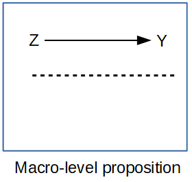

## Introduction

Counts are everywhere in demography. Births, deaths and migrants in a county; the number of children a woman has had; the number of days in the past month someone felt unwell. Before large surveys existed, almost all demography was done this way, on counts of events for places, and the rates we compute from them (birth rates, death rates, migration rates) are still the field's basic currency.

Counts are non-negative integers, they're often skewed, and their variance usually grows with their mean, so the linear model fits them badly. This week covers the generalized linear models built for counts, in two settings. The first is **rates for places**, where the key idea is the offset that turns a model for counts into a model for rates. The second is **counts for people**, where the key problem is usually too many zeros. @cameron_trivedi2013 is the standard reference for everything here.

## Setup

```{r}
#| label: packages
library(tidyverse)
library(here)
library(survey)
library(MASS, exclude = "select")
library(pscl)
library(modelsummary)
library(marginaleffects)
library(sparkscolors)

source(here("R", "get_ahrf.R"))
source(here("R", "get_mmsa.R"))
source(here("R", "recode_mmsa.R"))
```

```{r}
#| label: setup
#| include: false
options(survey.lonely.psu = "adjust")
theme_set(
  theme_minimal(base_size = 12) +
    theme(text = element_text(colour = utsa_cols("midnight")),
          panel.grid.major = element_line(colour = utsa_cols("smoke")),
          panel.grid.minor = element_blank(),
          legend.position = "bottom")
)
fmt <- function(x, d = 0) format(round(x, d), big.mark = ",", nsmall = d)
pct <- function(x, d = 1) paste0(format(round(100 * x, d), nsmall = d), "%")
```

## Demography and places

### Macro demography

Before large social surveys arrived in the 1960s, most demographic research was done on aggregates, not individuals, because that's how the data came. If you look at a text like @keyfitz1968, all of the examples are national-level calculations. Many countries didn't have enough data to produce good statistical summaries of their populations at all, which is why the United Nations Population Division's famous *Manual X* [-@un_manualx1983] gave pragmatic formulas for estimating demographic indicators from the basic inputs usually available in census summaries.

@voss2007 describes most demography before the 1970s and 1980s as **macro** demography. Before individual microdata existed, all demography was macro demography, and most of it was spatial, because the data were only available for administrative areas: counties, census tracts, ZIP codes, states and nations. In the macro view, the observations are places or other aggregates of people. Even if you have a count of deaths for a region broken down by age and sex, you still know nothing about the individual decedents beyond those categories. That isn't a criticism. Data like these are invaluable, and most demographic summaries of individual data aggregate by the same characteristics anyway.

{width=60%}

If all we looked at were the individuals in a population, we'd be overwhelmed by the variation, and we wouldn't be doing statistics anymore, we'd be processing a million anecdotes. The plural of anecdote is not data. Aggregating across basic demographic groups like age and sex is how demographers start to tease apart the differences we care about. If we go further and, data willing, aggregate within places too, we add an extremely important part of human existence: the *where* of where we live.

### Getting data on places

When we talk about data on places, we usually mean some administrative geography, and we often use it as a proxy for the more interesting social spaces we'd really like to study, like neighborhoods and activity spaces. Say I want to study inequality in mortality across neighborhoods in the United States. I immediately hit two hurdles. No national data source puts a sub-city residential location on death certificates, and what *is* a neighborhood, anyway? I might settle for a single state, because state vital registration systems will sometimes let researchers use the decedent's address, and a city may maintain its own neighborhood boundaries. But then I run into the "what's my denominator" problem: there are no official population estimates by age and sex for such small, locally defined areas. *This is frustrating.* When I advise students on dissertations, there's often a moment of truth where I lay out the problem of mixing geographic scales and the hard reality of how little data exist for many of the things they want to study.

What usually happens is that we proxy the places we want with places we can get data for. You see this all over the population health literature, where people want to analyze neighborhoods and what they have are census tracts. Tracts aren't social spaces! They're arbitrary areas of 3,000 to 5,000 people that change every ten years, drawn so the Census Bureau can count people. Counties have very rich data, but they aren't neighborhoods or activity spaces either, though they do have some policy-making authority (county health departments, for one) that *could* be relevant. States are very large, so you lose the ability to put behavior in a fine-scale context, but states make many decisions that affect their residents' lives, often more than national decisions do. They've become popular units of analysis in health research again, largely because states adopted different parts of the Affordable Care Act [@soni2017; @courtemanche2019]. Whatever the unit, an analysis of places has limitations we have to acknowledge. These are often called **ecological** analyses, because we're estimating associations at the macro scale without observing individual outcomes, and the associations don't necessarily hold for the individuals inside the places.

For U.S. places, a few sources cover most needs:

1. **`tigris`** downloads the Census Bureau's TIGER/Line boundary files (states, counties, tracts, and so on) as `sf` objects. They hold geography and GEOIDs, not demographic data, but the GEOIDs link them to every federal statistical product. `cb = TRUE` gets the smaller cartographic boundary files, which are what you want for maps.
2. **`tidycensus`** [@walker_tidycensus] uses the Census Bureau's API to download decennial census, ACS, population estimates, migration flows and PUMS data directly into R, with `geometry = TRUE` to attach the boundaries. You'll need the free API key from week 2.
3. **IPUMS NHGIS** [@nhgis] has census tables and boundary files for U.S. geographies going back to 1790, which is the place to go for historical work.
4. The **Area Health Resources File** has county data on health care, population and vital events, which we'll use below.

ACS estimates for small areas come with margins of error, and you should look at them before you map or model anything. The Census Bureau's MOEs are 90% intervals, so the standard error is the MOE divided by 1.645, and the coefficient of variation is the standard error divided by the estimate. Here's the share of families below the poverty line in Bexar County tracts. `tidycensus` looks for your key in the `CENSUS_API_KEY` environment variable, which `census_api_key("your key", install = TRUE)` sets up for you.

```{r}
#| label: acs-cv
#| fig-cap: "Coefficient of variation of the percent of families below poverty, Bexar County tracts, 2019-2023 ACS"
library(tidycensus)
bexar_pov <- get_acs(geography = "tract", state = "TX", county = "Bexar",
                     variables = "DP03_0119P",   # percent of families below poverty
                     year = 2023, geometry = TRUE, progress_bar = FALSE) |>
  mutate(se = moe / 1.645,
         cv = if_else(estimate > 0, se / estimate, NA_real_),  # CV is undefined at 0
         cv_class = cut(cv, breaks = c(0, 0.15, 0.3, 0.5, Inf),
                        labels = c("Under 0.15", "0.15 to 0.30", "0.30 to 0.50", "Over 0.50")))

ggplot(bexar_pov) +
  geom_sf(aes(fill = cv_class), colour = NA) +
  scale_fill_manual(values = utsa_pal("blues", interpolate = TRUE)(5)[2:5],
                    na.value = utsa_cols("concrete")[[1]],
                    labels = function(x) if_else(is.na(x), "Estimate of 0", x)) +
  labs(fill = "Coefficient of variation") +
  theme_void()

cv_rho  <- cor(bexar_pov$estimate, bexar_pov$cv, method = "spearman", use = "complete.obs")
cv_high <- mean(bexar_pov$cv > 0.3, na.rm = TRUE)
n_zero  <- sum(bexar_pov$estimate == 0, na.rm = TRUE)
```

The tracts with the least precise estimates are the ones with the *lowest* poverty rates, because so few sampled families there report incomes below the poverty line. The rank correlation between the poverty rate and its CV is `r round(cv_rho, 2)`. A CV above about 0.3 is a common warning sign, and `r scales::percent(cv_high)` of Bexar County tracts are over it. So a tract map of family poverty is mostly a map of noise, except in the poorest tracts. The `r n_zero` tracts with an estimate of zero don't have a CV at all, but a zero from a sample isn't a true zero either.

## Part 1: Rates for places

### The data

The Area Health Resources File (AHRF), from the Health Resources and Services Administration, compiles county data on health care, population, and vital events from dozens of federal sources. I'll model low birth weight births (under 2,500 grams) in U.S. counties, using the three-year totals of births and low birth weight births that the AHRF takes from NCHS natality data. `get_ahrf()` reads the 2024-2025 file and keeps the variables we need.

```{r}
#| label: ahrf
ahrf <- get_ahrf() |>
  mutate(rucc = as.integer(na_if(rucc, "")),
         metro = factor(if_else(rucc <= 3, "Metro", "Nonmetro")),
         hpsa = factor(case_when(hpsa == "0" ~ "None",
                                 hpsa == "2" ~ "Part county",
                                 hpsa == "1" ~ "Whole county"),
                       levels = c("None", "Part county", "Whole county")),
         lbw_rate = 1000 * lbw / births,
         suppressed = is.na(lbw) & !is.na(births))
```

The predictors are the percent of people in poverty, whether the county is metropolitan (rural-urban continuum codes 1 to 3), and whether it is a primary care health professional shortage area (HPSA), in whole or in part.

### A problem before we start: suppressed counts

```{r}
#| label: suppression
ahrf |>
  filter(!is.na(metro)) |>
  group_by(metro) |>
  summarise(counties = n(),
            n_suppressed = sum(suppressed),
            share_suppressed = mean(suppressed),
            median_births_suppressed = median(births[suppressed]),
            median_births_reported = median(births[!suppressed], na.rm = TRUE))
```

NCHS doesn't release counts below 10, so the AHRF has no low birth weight count for `r sum(ahrf$suppressed)` counties. They're missing, not zero, and they aren't missing at random. Most of them are small nonmetropolitan counties: about a third of nonmetro counties are suppressed, compared with fewer than one in ten metro counties. If we drop them, which is what I do below, the results describe counties with enough births to report, and the comparison between metro and nonmetro counties is a comparison between metro counties and the *larger* nonmetro counties. I'd name that limitation explicitly in a paper. Pooling more years, or using restricted-use natality files, are the usual ways around it.

```{r}
#| label: analysis-sample
ahrf_cc <- ahrf |>
  filter(!is.na(lbw), !is.na(births), !is.na(pov_pct), !is.na(metro), !is.na(hpsa))
nrow(ahrf_cc)
```

### Mapping the outcome

When the observations are places, a map is almost a required part of the analysis, and it often says more about the distribution of the outcome than a histogram or a table of summary statistics. `tigris` gets the county boundaries, and the AHRF's five-digit FIPS code joins them to the data. I show the suppressed counties in their own color rather than leaving them blank, because where the missing data are is part of the story. I also leave the county borders off, so they don't swamp the variation, and draw the state borders on top. For a map that will be shown to the public, I'd also add a scale bar and a north arrow (the `ggspatial` package does both).

```{r}
#| label: fig-lbw-map
#| fig-cap: "Low birth weight births per 1,000 births, U.S. counties, 2021-2023, in quintiles. Gray counties have suppressed counts."
#| fig-height: 6
options(tigris_use_cache = TRUE)

lower48 <- c("02", "15", "60", "66", "69", "72", "78")
counties_sf <- tigris::counties(cb = TRUE, year = 2023, resolution = "20m",
                                progress_bar = FALSE) |>
  filter(!STATEFP %in% lower48)
states_sf <- tigris::states(cb = TRUE, year = 2023, resolution = "20m",
                            progress_bar = FALSE) |>
  filter(!STATEFP %in% lower48)

lbw_map <- counties_sf |>
  left_join(ahrf, by = c("GEOID" = "fips_st_cnty")) |>
  mutate(lbw_q = cut(lbw_rate,
                     breaks = quantile(lbw_rate, probs = seq(0, 1, 0.2), na.rm = TRUE),
                     include.lowest = TRUE, dig.lab = 3),
         lbw_q = fct_na_value_to_level(lbw_q, "Suppressed"))

ggplot(lbw_map) +
  geom_sf(aes(fill = lbw_q), colour = NA) +
  geom_sf(data = states_sf, fill = NA, colour = "white", linewidth = 0.3) +
  # drop the Limestone end of the ramp so the lowest class stands apart from
  # the Concrete used for suppressed counties
  scale_fill_manual(values = set_names(c(utsa_pal("blues", interpolate = TRUE)(6)[2:6],
                                         utsa_cols("concrete")[[1]]),
                                       levels(lbw_map$lbw_q))) +
  coord_sf(crs = 5070) +
  labs(fill = "LBW per 1,000") +
  theme_void() +
  theme(legend.position = "bottom", text = element_text(colour = utsa_cols("midnight")))
```

The highest rates are concentrated in the Southeast, along the lower Mississippi, across the Black Belt of Alabama and Georgia and up into Appalachia, with another cluster in the high-altitude counties of Colorado, Wyoming and New Mexico. And the gray counties make the suppression problem visible: they're the sparsely populated counties of the Great Plains and the interior West.

### A GLM for every outcome

Week 3 introduced the generalized linear model, and here is the bigger picture. The linear model is the GLM with a Normal distribution and the identity link, and `glm()` with `family = gaussian` gives exactly the same estimates as `lm()`. The GLM summary reports the **deviance** where `lm()` reports the residual standard error, but for the Gaussian they're the same information: the deviance is the residual sum of squares, and the square root of the deviance divided by its degrees of freedom is the residual standard error.

Different distributions fit different kinds of outcomes, and each has a usual link function that keeps the linear predictor on the scale of the mean [@nelder_wedderburn1972; @mccullagh_nelder1989]:

| Distribution | Mean | Variance | Usual link | Range of outcome |
|:--|:--|:--|:--|:--|
| Gaussian | $\mu$ | $\sigma^2$ | Identity | $(-\infty, \infty)$ |
| Binomial | $\pi$ | $n\pi(1 - \pi)$ | $\log\left(\frac{\pi}{1 - \pi}\right)$ | $\frac{0, 1, 2, \dots, n}{n}$ |
| Poisson | $\lambda$ | $\lambda$ | $\log(\lambda)$ | $0, 1, 2, \dots$ |
| Negative binomial | $\mu$ | $\mu + \mu^2/\theta$ | $\log(\mu)$ | $0, 1, 2, \dots$ |
| Gamma | $\mu$ | $\phi\mu^2$ | $\log(\mu)$ | $(0, \infty)$ |

These aren't all the possibilities, but they're the ones you'll use most, and they're available in almost any statistics package. The `VGAM` package (which we used last week) and `gamlss` add many more.

### Rates and offsets

The **Poisson model** says that the count $y_i$ in county $i$ has mean $\mu_i$, with variance equal to the mean, and models the log of the mean:

$$
\log(\mu_i) = \mathbf{x}_i'\boldsymbol\beta
$$

But a county with 50,000 births will have more low birth weight births than a county with 500 for no reason other than its size. What we care about is the rate, $\mu_i / n_i$, where $n_i$ is the number of births. Taking logs,

$$
\log\left(\frac{\mu_i}{n_i}\right) = \mathbf{x}_i'\boldsymbol\beta
\quad\Longleftrightarrow\quad
\log(\mu_i) = \log(n_i) + \mathbf{x}_i'\boldsymbol\beta
$$

The term $\log(n_i)$ is the **offset**. It's a predictor whose coefficient is fixed at 1, and it turns the count model into a rate model. Any model for demographic counts across units of different sizes needs an offset (or a denominator of some kind), and the most common mistake I see in student papers is leaving it out.

So there are really three ways to use the Poisson for places:

1. **A pure count model**, $\log(\lambda_i) = \mathbf{x}_i'\boldsymbol\beta$, which only makes sense if every place has the same population or area. That almost never happens in demographic data, so you'll rarely use it.
2. **A rate model**, with the log of the population at risk as the offset. This is the most common way demographic counts are analyzed, and it's the model above.
3. **A relative risk model**, with the log of an *expected* count as the offset, which I come back to at the end of Part 1.

Whichever you use, the coefficients are on the log scale, and you exponentiate them to interpret them. If $\beta_1 = 0.025$, then $\exp(0.025) = 1.025$. In a pure count model, a one-unit increase in $x_1$ multiplies the mean count by 1.025, so if the mean is 10 when $x_1 = 0$, it's 10.25 when $x_1 = 1$. In a rate model, the same coefficient multiplies the *rate* by 1.025, a 2.5% increase.

One practical note: every place needs a population (or expected count) greater than zero, because $\log(0)$ isn't a number and `glm()` will stop with an error. The AHRF counties with suppressed birth counts are already gone from `ahrf_cc`, so that's not a problem here.

```{r}
#| label: poisson
fit_pois <- glm(lbw ~ offset(log(births)) + pov_pct + metro + hpsa,
                family = poisson, data = ahrf_cc)
summary(fit_pois)
```

Exponentiated Poisson coefficients are **rate ratios**. Each percentage point of poverty is associated with a low birth weight rate `r pct(exp(coef(fit_pois)[["pov_pct"]]) - 1)` higher, and nonmetro counties have rates `r pct(1 - exp(coef(fit_pois)[["metroNonmetro"]]))` lower than metro counties with the same poverty and shortage status. The intercept, exponentiated, is the rate in a metro, non-shortage county with zero poverty: `r round(1000 * exp(coef(fit_pois)[["(Intercept)"]]), 1)` per 1,000 births.

Here is what happens without the offset:

```{r}
#| label: no-offset
fit_no_offset <- glm(lbw ~ pov_pct + metro + hpsa, family = poisson, data = ahrf_cc)
round(cbind(with_offset = coef(fit_pois), without_offset = coef(fit_no_offset)), 3)
```

Without the offset, the nonmetro coefficient says nonmetro counties have about `r pct(1 - exp(coef(fit_no_offset)[["metroNonmetro"]]), 0)` fewer low birth weight births, which is true and useless: they have fewer births of every kind. The model is describing county size, not risk.

### Overdispersion

The Poisson assumes the variance equals the mean. Counts for places almost never behave that way, because counties differ in many ways the model doesn't include. A quick check is the Pearson chi-square divided by its degrees of freedom, which should be near 1.

```{r}
#| label: dispersion
sum(residuals(fit_pois, type = "pearson")^2) / fit_pois$df.residual
```

A dispersion of about `r round(sum(residuals(fit_pois, type = "pearson")^2) / fit_pois$df.residual, 1)` means the variance is nearly three times what the Poisson assumes, so the Poisson standard errors are too small. If overdispersion is present and we ignore it, we can call a relationship significant when it isn't.

The residual deviance gives a formal goodness-of-fit test, because if the model is right it has a $\chi^2$ distribution with the residual degrees of freedom ($n - p$):

```{r}
#| label: deviance-gof
c(deviance = deviance(fit_pois), df = df.residual(fit_pois),
  p = pchisq(deviance(fit_pois), df.residual(fit_pois), lower.tail = FALSE))
```

A p-value of essentially zero says the Poisson doesn't fit these data. (If the p-value were above 0.05, we couldn't reject the hypothesis that it does.) There are two common fixes.

The **quasi-Poisson** model keeps the Poisson estimates and adds a dispersion parameter, so that $\text{Var}(y_i) = \phi\lambda_i$ instead of $\lambda_i$. In the Poisson, $\phi$ is fixed at 1, and in the quasi-Poisson it's estimated, which multiplies every standard error by $\sqrt{\phi}$. The **negative binomial** model adds a parameter that lets the variance grow faster than the mean. It's a real likelihood, so it can be compared with the Poisson by AIC, and its estimates differ a little from the Poisson's because it weights the counties differently.

The negative binomial comes in two common forms. The **NB1** model lets the variance grow linearly with the mean, and the **NB2** model, the one most software fits, lets it grow with the square of the mean:

$$
\text{NB1: } \text{Var}(y_i) = \lambda_i + \theta\lambda_i \qquad\qquad \text{NB2: } \text{Var}(y_i) = \lambda_i + \lambda_i^2/\theta
$$

`MASS::glm.nb()` fits NB2. (NB1 looks a lot like the quasi-Poisson, but it's a full likelihood.) `glmmTMB` fits both, with `family = nbinom1` and `nbinom2`, and `gamlss` fits both along with a long list of other distributions, and lets you model the variance as well as the mean.

```{r}
#| label: overdispersion-models
fit_qp <- glm(lbw ~ offset(log(births)) + pov_pct + metro + hpsa,
              family = quasipoisson, data = ahrf_cc)
fit_nb <- glm.nb(lbw ~ offset(log(births)) + pov_pct + metro + hpsa, data = ahrf_cc)

modelsummary(list("Poisson" = fit_pois, "Quasi-Poisson" = fit_qp,
                  "Negative binomial" = fit_nb),
             exponentiate = TRUE, fmt = 3,
             statistic = "({std.error})",
             gof_map = c("nobs", "aic"),
             title = "Rate ratios for low birth weight, U.S. counties")

AIC(fit_pois, fit_nb)
```

The negative binomial fits far better by AIC. The poverty rate ratio is a bit larger, and the shortage area effects, which looked clearly significant in the Poisson, are much less certain once the extra variation is accounted for. That is the general pattern: an overdispersed Poisson overstates how much you know.

The quasi-Poisson's coefficients are identical to the Poisson's, and its standard errors are not. Form the ratio of the two sets of standard errors and it's the same for every coefficient:

```{r}
#| label: qp-ratio
se_ratio <- sqrt(diag(vcov(fit_qp))) / sqrt(diag(vcov(fit_pois)))
round(se_ratio, 3)
sqrt(summary(fit_qp)$dispersion)
```

Every ratio is exactly $\sqrt{\phi}$, the square root of the quasi-Poisson dispersion, and $\phi$ is the same Pearson dispersion we computed above. That's all the quasi-Poisson does. It's a quick fix, but because it's fit by quasi-likelihood, it has no AIC and can't be compared with other models that way. @breslow1984 proposed a model that adds an extra-Poisson variance parameter and is fit by reweighted maximum likelihood, so each coefficient's standard error gets its own adjustment instead of one common factor, and the `dispmod` package implements it.

### The binomial alternative

Low birth weight births are a subset of births, so a binomial model for the proportion is also natural. `glm()` takes the outcome as the number of successes and failures:

```{r}
#| label: binomial
fit_bin <- glm(cbind(lbw, births - lbw) ~ pov_pct + metro + hpsa,
               family = binomial, data = ahrf_cc)
round(cbind(poisson = coef(fit_pois), binomial = coef(fit_bin)), 3)
```

The coefficients are close, because when an outcome is uncommon (about 8% of births here), the odds and the rate are nearly the same thing. For common outcomes they diverge, and the binomial is the better choice when the count can't exceed the denominator.

With the count-based binomial, the odds ratio interpretation is less natural than it is for individuals, and when I interpret these coefficients I describe them as approximate *percent changes in the rate*. The poverty coefficient exponentiates to `r round(exp(coef(fit_bin)[["pov_pct"]]), 3)`, so the odds of a low birth weight birth are `r pct(exp(coef(fit_bin)[["pov_pct"]]) - 1)` higher for every percentage point of poverty. `predictions()` shows what that means for the rate itself, for two counties that differ by one point of poverty:

```{r}
#| label: binomial-pct
bin_pred <- predictions(fit_bin, newdata = datagrid(pov_pct = c(15, 16), metro = "Metro",
                                                    hpsa = "None"))
bin_pred[, c("pov_pct", "estimate")]
bin_pred$estimate[2] / bin_pred$estimate[1] - 1
```

The rate rises by `r pct(bin_pred$estimate[2] / bin_pred$estimate[1] - 1, 2)`, a little less than the odds. With an outcome this uncommon the two are close, which is why reading the odds ratio as a percent change in the rate is a reasonable shorthand here, and why it stops being reasonable as the outcome gets more common.

The **beta distribution** is another option for proportions. It lives between 0 and 1, like the binomial's $\pi$, but it has its own precision parameter, so it sidesteps the overdispersion that so often plagues the binomial. `betareg` fits it [@cribari_neto_zeileis2010], with the same logit, probit or complementary log-log links, and a second formula after `|` models the precision too. It works on the observed proportions, so it doesn't know that a rate based on 20 births is less reliable than one based on 20,000, which is a real disadvantage for county data like these.

```{r}
#| label: betareg
#| eval: false
library(betareg)
fit_beta <- betareg(I(lbw / births) ~ pov_pct + metro + hpsa, data = ahrf_cc)
fit_beta_disp <- betareg(I(lbw / births) ~ pov_pct + metro + hpsa | metro, data = ahrf_cc)
AIC(fit_beta, fit_beta_disp)
```

### Age standardization in a regression model

The binomial and the Poisson also give us a regression version of age standardization. Crude death rates mix two things: how likely people are to die at each age, and how many people there are at each age. To compare places fairly, we need to hold the age structure constant. I'll use deaths and population by age for Texas and California in 2016, from the CDC WONDER Compressed Mortality File.

```{r}
#| label: txca-data
age_levels <- c("< 1 year", "1-4 years", "5-9 years", "10-14 years", "15-19 years",
                "20-24 years", "25-34 years", "35-44 years", "45-54 years",
                "55-64 years", "65-74 years", "75-84 years", "85+ years")

txca <- read_tsv(here("data", "CMF_TX_CA_age.txt"), na = c("", "Not Applicable", "Suppressed"),
                 show_col_types = FALSE) |>
  rename(state = State, age = `Age Group`, deaths = Deaths, population = Population) |>
  filter(age != "Not Stated") |>
  mutate(age = factor(age, levels = age_levels),
         state = factor(state, levels = c("California", "Texas")),
         deaths = as.numeric(deaths), population = as.numeric(population)) |>
  select(state, age, deaths, population)

txca |>
  group_by(state) |>
  summarise(deaths = sum(deaths), population = sum(population)) |>
  mutate(crude_rate = 1e5 * deaths / population)
```

```{r}
#| label: fig-txca-age
#| fig-cap: "Age distributions of Texas and California, 2016. The jump at 25-34 is because the age groups widen to ten years after age 25."
txca |>
  group_by(state) |>
  mutate(share = population / sum(population)) |>
  ggplot(aes(x = age, y = share, colour = state, linetype = state, group = state)) +
  geom_line(linewidth = 1.2) +
  geom_point(size = 2) +
  scale_colour_utsa(palette = "primary") +
  scale_y_continuous(labels = scales::label_percent()) +
  labs(x = "Age group", y = "Share of population", colour = NULL, linetype = NULL) +
  theme(axis.text.x = element_text(angle = 45, hjust = 1))
```

Texas has a younger population than California, so its crude death rate understates its mortality relative to California's. To standardize in the regression framework, we put age in the model. The state coefficient is then the difference between the states *holding the age structure constant*, which is the difference in age-standardized rates.

```{r}
#| label: txca-models
fit_txca_bin <- glm(cbind(deaths, population - deaths) ~ age + state,
                    family = binomial, data = txca)
fit_txca_pois <- glm(deaths ~ offset(log(population)) + age + state,
                     family = poisson, data = txca)
fit_txca_crude <- glm(deaths ~ offset(log(population)) + state,
                      family = poisson, data = txca)

exp(c(crude = coef(fit_txca_crude)[["stateTexas"]],
      binomial = coef(fit_txca_bin)[["stateTexas"]],
      poisson = coef(fit_txca_pois)[["stateTexas"]]))
```

```{r}
#| label: txca-values
#| include: false
rr_crude <- exp(coef(fit_txca_crude)[["stateTexas"]])
rr_std <- exp(coef(fit_txca_pois)[["stateTexas"]])
```

Without age in the model, Texas's death rate looks only `r pct(rr_crude - 1)` higher than California's. After standardizing for age, Texas has a mortality rate `r pct(rr_std - 1)` higher, and the binomial and Poisson models agree almost exactly. This is a model-based relative of the direct and indirect standardization you've done by hand, and next week's Kitagawa decomposition will split a crude difference like this one into the part due to rates and the part due to composition.

### Expected counts and standardized ratios

Epidemiologists often use the **expected count** as the offset instead of the population. The expected count is what a county would have if it had the overall rate: $E_i = n_i \times \sum_j y_j / \sum_j n_j$. This is internal standardization, and the ratio $y_i / E_i$ is the standardized incidence ratio (SIR).

```{r}
#| label: expected
overall_rate <- sum(ahrf_cc$lbw) / sum(ahrf_cc$births)

ahrf_cc <- ahrf_cc |>
  mutate(expected = births * overall_rate,
         sir = lbw / expected)

fit_sir <- glm.nb(lbw ~ offset(log(expected)) + pov_pct + metro + hpsa, data = ahrf_cc)
round(cbind(births_offset = coef(fit_nb), expected_offset = coef(fit_sir)), 4)
```

Only the intercept changes, because $\log(E_i) = \log(n_i) + \log(\text{overall rate})$, and the constant moves into the intercept. Choosing between these offsets is about what the intercept and the fitted values mean, not about the covariate effects. With age-specific rates in the expected count (indirect standardization), the SIR also adjusts for age, which is the usual reason to use it for mortality.

Here's that for Texas and California. The naive expected count uses the crude death rate of both states combined. The age-specific version applies each age group's combined death rate to each state's population in that age group.

```{r}
#| label: txca-expected
txca <- txca |>
  mutate(e_crude = population * sum(deaths) / sum(population)) |>
  group_by(age) |>
  mutate(e_age = population * sum(deaths) / sum(population)) |>
  ungroup()

txca |>
  group_by(state) |>
  summarise(observed = sum(deaths), expected_crude = sum(e_crude),
            expected_age = sum(e_age)) |>
  mutate(smr_age = observed / expected_age)

fit_rr <- glm(deaths ~ offset(log(e_age)) + age + state, family = poisson, data = txca)
exp(coef(fit_rr)[["stateTexas"]])
```

Summed over age, the expected counts based on the crude rate look closer to the observed deaths, but that's an illusion. They ignore age, so they credit California's older population with too few expected deaths and Texas's younger population with too many. Once the expected counts use age-specific rates, Texas has `r pct(sum(txca$deaths[txca$state == "Texas"]) / sum(txca$e_age[txca$state == "Texas"]) - 1)` more deaths than its age structure would predict, and California has `r pct(1 - sum(txca$deaths[txca$state == "California"]) / sum(txca$e_age[txca$state == "California"]))` fewer. In the model with age-specific expected counts, the Texas rate ratio is identical to the one from the rate model, even though the offset is different. Different denominators, same comparison.

```{r}
#| label: fig-sir
#| fig-cap: "Standardized incidence ratios for low birth weight by county poverty rate. Point size reflects the number of births; counties above 1 have more low birth weight births than expected."
ahrf_cc |>
  ggplot(aes(x = pov_pct, y = sir, size = births)) +
  geom_hline(yintercept = 1, colour = utsa_cols("smoke"), linewidth = 1) +
  geom_point(alpha = 0.4, colour = utsa_cols("midnight")) +
  geom_smooth(aes(weight = births), method = "loess", se = FALSE,
              colour = utsa_cols("orange"), linewidth = 1.2, show.legend = FALSE) +
  scale_size_area(max_size = 6, guide = "none") +
  labs(x = "Percent of persons in poverty", y = "Standardized incidence ratio")
```

## Part 2: Counts for people

### Poor mental health days

The BRFSS asks, "Now thinking about your mental health, which includes stress, depression, and problems with emotions, for how many days during the past 30 days was your mental health not good?" `recode_mmsa()` turns the answers into `ment_days`, from 0 to 30.

```{r}
#| label: ment-days
brfss <- get_mmsa(2024) |>
  recode_mmsa() |>
  mutate(complete = complete.cases(ment_days, agec, female, educ, race_eth, income))

des <- svydesign(ids = ~1, strata = ~ststr, weights = ~mmsawt, data = brfss)
```

```{r}
#| label: fig-ment-days
#| fig-cap: "Distribution of poor mental health days in the past 30 days, 2024 BRFSS SMART MMSA (weighted)."
svytable(~ment_days, des) |>
  as_tibble() |>
  mutate(ment_days = as.integer(ment_days),
         share = n / sum(n)) |>
  ggplot(aes(x = ment_days, y = share)) +
  geom_col(fill = utsa_cols("midnight")) +
  scale_y_continuous(labels = scales::label_percent()) +
  labs(x = "Days of poor mental health, past 30 days", y = "Share of adults")
```

```{r}
#| label: ment-values
#| include: false
share0 <- coef(svymean(~I(ment_days == 0), des, na.rm = TRUE))[[2]]
mean_days <- coef(svymean(~ment_days, des, na.rm = TRUE))[[1]]
```

This is a very typical count distribution for a survey question. About `r pct(share0, 0)` of adults report no poor mental health days, the rest are spread out with a long tail, and there are spikes at 5, 10, 15, 20 and 30, because people round. The spike at 30 is also a ceiling: "every day" is as high as the question goes. The weighted mean is `r round(mean_days, 1)` days.

### A population-average model

If what we want is the mean number of days in the population, and how it differs across groups, a Poisson-type model fit with `svyglm()` does the job. The `quasipoisson` family gives the same point estimates as the Poisson and lets the design-based standard errors handle the overdispersion.

```{r}
#| label: svy-quasipoisson
fit_svy <- svyglm(ment_days ~ agec + female + educ + race_eth + income,
                  design = subset(des, complete), family = quasipoisson())

modelsummary(list("Survey quasi-Poisson" = fit_svy), exponentiate = TRUE,
             fmt = 3, gof_map = "nobs",
             title = "Rate ratios for poor mental health days")
```

The rate ratios read like the county model: adults 65 and older report `r pct(1 - exp(coef(fit_svy)[["agec65+"]]), 0)` fewer poor mental health days than adults 18 to 24, and adults with household incomes of $100,000 or more report `r pct(1 - exp(coef(fit_svy)[["income$100k+"]]), 0)` fewer than those under $25,000. For many questions this is the model I'd report, because it answers a population question with design-based inference.

### Where do the zeros come from?

Sometimes the zeros themselves are the interesting part. A zero can mean two different things: someone whose mental health was fine this month but who has bad stretches, or someone who basically never has poor mental health days. Two families of models take this seriously [@zeileis2008].

**Zero-inflated models** [@lambert1992] say that there are two kinds of people: "structural" zeros, who can only report 0, and everyone else, whose counts follow a Poisson or negative binomial that can also produce zeros. A logit models membership in the structural zero group, and a count model handles the rest.

**Hurdle models** [@mullahy1986] say that there's one process for whether you have any days at all (crossing the hurdle), and a second process, a count model truncated at zero, for how many days you have once you've crossed it.

The difference is subtle but real. In a zero-inflated model, zeros come from both parts. In a hurdle model, all zeros come from the first part, and the count part only describes people with at least one day. I find hurdle models easier to explain, because each part answers a plain question: who has any poor mental health days, and among them, how many?

### Fitting and comparing the models

`pscl` fits both. It takes weights but not a survey design, so I pass the survey weights scaled to average 1. The point estimates then describe the population, but the standard errors treat the data as a simple random sample, so they're too small. With almost 180,000 respondents that matters less than usual, but I wouldn't report these standard errors in a paper without fixing them (with replicate weights, as in week 2).

```{r}
#| label: count-models
cc <- brfss |>
  filter(complete) |>
  mutate(w = mmsawt / mean(mmsawt))

f_counts <- ment_days ~ agec + female + educ + race_eth + income

fit_p <- glm(f_counts, family = poisson, data = cc, weights = w)
fit_n <- glm.nb(f_counts, data = cc, weights = w)
# two-part formulas: count model | zero (or hurdle) model
f_two <- ment_days ~ agec + female + educ + race_eth + income |
  agec + female + educ + race_eth + income

fit_zinb <- zeroinfl(f_two, dist = "negbin", data = cc, weights = w)
fit_hnb <- hurdle(f_two, dist = "negbin", data = cc, weights = w)
```

Since the weighted likelihoods aren't true likelihoods, I won't compare these models by AIC. A more useful check is whether each model reproduces the distribution of the outcome. For each model, I average the predicted probability of every count from 0 to 30 and compare it with the observed distribution.

```{r}
#| label: expected-frequencies
counts <- 0:30
wmean <- function(p) colSums(p * cc$w) / sum(cc$w)

freq <- tibble(
  days = counts,
  Observed = map_dbl(counts, \(k) weighted.mean(cc$ment_days == k, cc$w)),
  Poisson = wmean(sapply(counts, \(k) dpois(k, fitted(fit_p)))),
  `Negative binomial` = wmean(sapply(counts, \(k) dnbinom(k, mu = fitted(fit_n),
                                                         size = fit_n$theta))),
  `Zero-inflated NB` = wmean(predict(fit_zinb, type = "prob", at = counts)),
  `Hurdle NB` = wmean(predict(fit_hnb, type = "prob", at = counts))
)

freq |>
  filter(days %in% c(0, 1, 2, 5, 10, 15, 20, 30)) |>
  knitr::kable(digits = 3)
```

```{r}
#| label: fig-expected-frequencies
#| fig-cap: "Observed and model-predicted distributions of poor mental health days. Bars are observed shares; lines are the average predicted probabilities from each model."
freq_long <- freq |>
  pivot_longer(-c(days, Observed), names_to = "model", values_to = "predicted") |>
  mutate(model = fct_inorder(model))

ggplot(freq, aes(x = days)) +
  geom_col(aes(y = Observed), fill = utsa_cols("concrete")) +
  geom_line(data = freq_long, aes(y = predicted, colour = model, linetype = model),
            linewidth = 1.3) +
  geom_point(data = freq_long, aes(y = predicted, colour = model, shape = model),
             size = 1.8) +
  scale_colour_utsa() +
  scale_y_sqrt(labels = scales::label_percent()) +
  labs(x = "Days of poor mental health", y = "Share (square root scale)",
       colour = NULL, linetype = NULL, shape = NULL)
```

```{r}
#| label: freq-values
#| include: false
f0 <- freq |> filter(days == 0)
f15 <- freq |> filter(days >= 15) |> summarise(across(-days, sum))
```

The Poisson is hopeless: it predicts that only `r pct(f0$Poisson)` of adults would report zero days, against `r pct(f0$Observed)` observed. The negative binomial gets much closer (`r pct(f0$"Negative binomial")`), which is a reminder that "too many zeros" is often just overdispersion, and a negative binomial may be all you need. The zero-inflated and hurdle models match the zeros almost exactly. The hurdle model matches them by construction, since its first part is a logit for zero versus not.

But look at the other end of the distribution, because none of the models gets it right. `r pct(f15$Observed)` of adults report 15 or more poor mental health days, and even the hurdle model predicts only `r pct(f15$"Hurdle NB")`. The spike at 30 is the worst of it. The negative binomial family expects a long, thinning tail, and these data have a second mode at the ceiling, made up of people whose mental health was poor every day, or nearly so. The heaping at 5, 10 and 15 is a smaller version of the same problem, since nothing in a count distribution knows that people round. So the zero-inflated and hurdle models fix the zeros and leave a real misfit in the tail. That's worth knowing before you interpret their count-part coefficients too literally, and it's a good reason to try a model built for a bounded outcome (see the note at the end of this section).

### Interpreting the hurdle model

```{r}
#| label: hurdle-table
show_terms <- c("agec65+", "female", "educCollege graduate", "race_ethHispanic",
                "income$100k+")

tibble(term = show_terms,
       `Any days (odds ratio)` = exp(coef(fit_hnb, model = "zero")[show_terms]),
       `Number of days (rate ratio)` = exp(coef(fit_hnb, model = "count")[show_terms])) |>
  knitr::kable(digits = 2)
```

```{r}
#| label: hurdle-values
#| include: false
hz <- coef(fit_hnb, model = "zero")
hc <- coef(fit_hnb, model = "count")
```

Here is where the two parts earn their keep. Look at college graduates, compared with adults who didn't finish high school. In the zero part, which models the odds of reporting *any* poor mental health days, the odds ratio is `r round(exp(hz[["educCollege graduate"]]), 2)`: college graduates are *more* likely to report at least one bad day. In the count part, among people with at least one day, college graduates report `r pct(1 - exp(hc[["educCollege graduate"]]), 0)` *fewer* days. The population-average model from earlier mixes these two opposite patterns into a single rate ratio of `r round(exp(coef(fit_svy)[["educCollege graduate"]]), 2)`, which hides both. Whether the first pattern is about mental health or about how people with more education answer survey questions about it is a good question, and exactly the kind of thing the model can't settle for you.

::: {.callout-note}
Because the outcome can't exceed 30, a model for "days out of 30" is a natural alternative. The plain binomial will be badly overdispersed, but the beta-binomial allows for people who are mostly at one end or the other, which is exactly the U shape these data have. `glmmTMB(cbind(ment_days, 30 - ment_days) ~ ..., family = betabinomial)` fits it, and comparing its predicted distribution with the ones above is a good project.
:::

## Exercises

These exercises are Homework 6.

**1.** Fit a negative binomial model for low birth weight in counties that adds the number of general OB-GYNs per 10,000 population (`obgyn` and `popn_est_23`). Report the rate ratio and explain why you might expect this association to be confounded by county size even with the offset.

```{r}
#| label: ex-obgyn
#| eval: false
# YOUR CODE HERE
```

**2.** The AHRF also has three-year totals of deaths (`deth_3yr_avg_23`) and population estimates. Modify `get_ahrf()` (or read the file directly) to get them, and fit a model for county crude death rates with a population offset. Then explain, in two or three sentences, why a model for crude death rates across counties without age standardization is hard to interpret.

```{r}
#| label: ex-deaths
#| eval: false
# YOUR CODE HERE
```

<details>
<summary>A hint for exercise 2</summary>

Copy `get_ahrf()` to your own project, add `deaths = deth_3yr_avg_23` to the `select()`, and change the cache file name so you don't overwrite the course copy. For the second part, think about what the share of the population over 65 does to a county's crude death rate.

</details>

**3.** Fit a survey-weighted quasi-Poisson model for poor *physical* health days (`phys_days`) with the same predictors as the mental health model. Compare the rate ratios with the mental health model. Which predictors differ most?

```{r}
#| label: ex-phys-days
#| eval: false
# YOUR CODE HERE
```

**4.** Fit a zero-inflated negative binomial model and a hurdle negative binomial model for `phys_days`. Compare their predicted distributions with the observed distribution, as in this document, and interpret the education coefficients from both parts of the hurdle model.

```{r}
#| label: ex-phys-hurdle
#| eval: false
# YOUR CODE HERE
```

## References

::: {#refs}
:::
