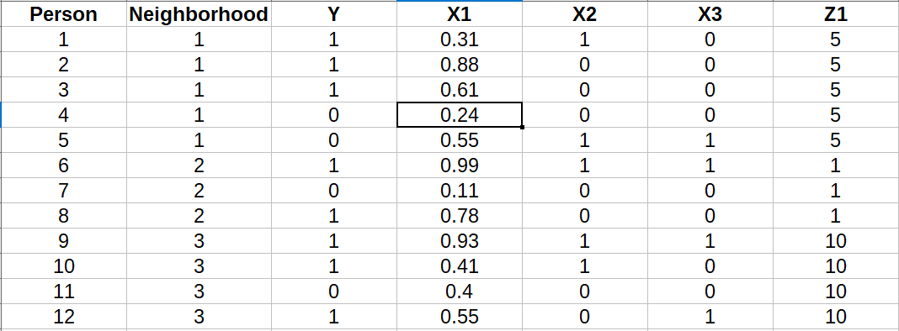
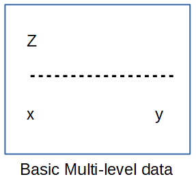
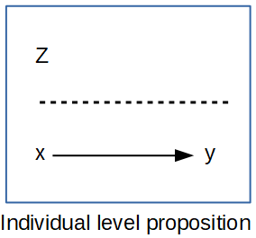
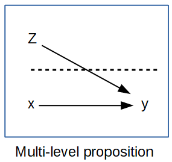
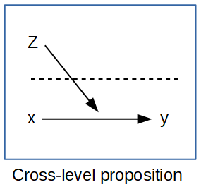

## Introduction

Demographers have always cared about where people live, and in week 6 we modeled places directly. This week and next, we put people back *inside* places: individual outcomes, individual predictors, and characteristics of the places they live, in one model. That's what multilevel models are for. This week covers the basic model, how much of the variation in an outcome is between places, how to center predictors so the coefficients mean what you think they mean, random slopes, and how to use survey weights in a multilevel model, which is harder than it sounds. Next week extends all of this to binary outcomes, growth curves and age-period-cohort models.

## A fundamental problem of names

Before we start, the vocabulary. These models go by many names, depending on the discipline you come from:

1. **Mixed effects models** (statistics and biostatistics),
2. **Hierarchical models** (education and sociology),
3. **Random effects models** (economics and epidemiology),
4. and **multilevel models**, which is what I'll mostly call them.

They're all the same model. Different disciplines, authors and software have managed to confuse us all, but if you see any of these names, it's this.

## Some perspectives on multilevel modeling

A multilevel framework is interested in outcomes that are clustered by space or time or some other linking characteristic, like cohort of birth or period of life. The processes that affect an outcome are thought to operate both at the individual level and at some structural level: the household, the neighborhood, the social network, the city. Those structural processes are thought to be causal to some degree, or at least we can construct an argument about how they *could* cause the outcome. And any multilevel perspective is interested in describing how much of the variation in the population is attributable to differences between these contexts, because that variation is worth knowing about beyond the individual.

### Multilevel data structure

Most statistical models assume that the observations are independent of one another. One thing that violates that assumption, as we've seen several times this semester, is people living in the same place. Following Tobler's law, things that are close together are more alike than things that are far apart, so if two people are sampled from the same neighborhood, they're likely to be more alike than two people sampled at random.

Survey design makes this worse, or at least makes it visible. As we saw in week 2, most surveys sample people in clusters, because it's cheaper. The ECLS-K samples counties, then schools within counties, then children within schools, which is a three-stage design. Children in the same classroom are more alike than children in the same district, and observations at every level could be correlated.

Here's a picture of a one-stage design, from week 2. Some neighborhoods are sampled (solid lines) and some aren't (dotted lines), and within the sampled neighborhoods, some people are sampled (circles) and some aren't (X's).

{width=70%}

The data from a design like this look like the table below: 12 people in three neighborhoods, each with an outcome $Y$ and three individual predictors, $X_1$ to $X_3$. There's also a neighborhood-level variable, $Z_1$, which is the same for everyone in a neighborhood but differs between neighborhoods. A real example would be the neighborhood poverty rate.

{width=70%}

### Multilevel propositions

When a research question involves individuals within some context, it's a **multilevel proposition**. Using the data structure above, with an outcome $Y$ and a predictor $X$ measured on individuals and a contextual variable $Z$ measured on neighborhoods:

{width=50%}

1. An **individual-level** (micro) proposition relates $X$ to $Y$ for individuals: a person's education affects their health.

    {width=40%}

2. A **macro-level** proposition relates $Z$ to $Y$ measured on places, as in week 6: metros with higher poverty rates have higher mortality rates. This is an **ecological** analysis, because we see no variation within places.

    {width=40%}

3. A **multilevel** proposition uses both $X$ and $Z$ to understand an individual outcome: for people with the same education, does living in a high-poverty area affect health? We're usually looking for the *net* effect of $Z$ after accounting for $X$.

    {width=40%}

4. A **cross-level interaction** asks whether the effect of $X$ depends on $Z$: people with less education *and* who live in high-poverty areas have higher risk of poor health. The important word is *and*.

    {width=40%}

## The multilevel model

### Starting from ANOVA

The basic multilevel model is a direct analog of the analysis of variance. In an ANOVA, the mean of group $j$ is

$$E(y_j) = \mu + u_j$$

the overall mean $\mu$ plus a deviation $u_j$ for each group. With 3 to 5 groups, that's efficient, and the $u_j$ are **fixed effects**, estimated relative to a reference group. With dozens or hundreds of groups, it gets awkward. People in 10% of U.S. counties would mean over 300 groups and 300 parameters, and why compare every county to one arbitrary reference county?

The multilevel model estimates the overall mean $\mu$ and treats the group deviations as draws from a normal distribution, $u_j \sim N(0, \sigma^2_u)$. That's a **random effect**. You can still recover a mean for every group, but the model has (technically) two parameters, $\mu$ and $\sigma^2_u$. Add individual predictors and you have a **mixed** model, with fixed effects $\beta_k$ and a random effect $u_j$:

$$y_{ij} = \beta_{0j} + \sum_k \beta_k x_{kij} + e_{ij}$$
$$\beta_{0j} = \beta_0 + u_j$$

The $u_j$ are the **random intercepts**. Software rarely prints them, because there can be many, but every package reports their variance, $\sigma^2_u$.

### Components of variation

With a normally distributed outcome, there are two sources of variation: the person-level residual $e_{ij}$ with variance $\sigma^2_e$, and the between-group variation $u_j$ with variance $\sigma^2_u$. The total variance is $\sigma^2_y = \sigma^2_e + \sigma^2_u$, and the **intraclass correlation** is

$$\text{ICC} = \frac{\sigma^2_u}{\sigma^2_u + \sigma^2_e}$$

The ICC is the share of the variance that's between groups, and it's also the correlation between two randomly chosen people in the same randomly chosen group: how similar you are, on average, to one of your neighbors. It runs from 0 to 1. An ICC of 0.5 is very large, and 0.01 means you're barely more like your neighbors than like a stranger.

### When to use fixed effects and when to use random effects

1. Use fixed effects (dummy variables) when each group is unique, you want conclusions about each one, and you know all of them in advance: sex, race and ethnicity, the four census regions.
2. Use random effects when the groups can be thought of as a sample from a (real or hypothetical) population of groups, like metro areas, schools or counties, and you want conclusions about that population. With more than 10 or so groups, you're probably not interested in every pairwise difference, and the model has many parameters you don't care about.

Week 10 added a third consideration: a random effects model assumes the group effects are unrelated to the predictors. Centering, below, is how we deal with that.

### Multilevel data sources

Not every question is multilevel, and not every data set can support a multilevel analysis. Public-use files that identify a geographic level include the ECLS-K (school identifiers), the BRFSS (metro areas), the ACS (PUMA, metro and state), and the Demographic and Health Surveys (regions, and GPS coordinates for clusters). Others, like NHANES, the NHIS, Add Health, the PSID and the NLSY, identify geography only in restricted-use files.

## Setup

`lme4` fits multilevel models [@bates2015], and `WeMix` fits them with survey weights [@wemix]. `get_mmsa_context()` downloads metro-level characteristics from the ACS.

```{r}
#| label: packages
library(tidyverse)
library(here)
library(lme4)
library(WeMix)
library(modelsummary)
library(sparkscolors)  # pak::pak("coreysparks/sparkscolors"), UTSA colors

source(here("R", "get_mmsa.R"))
source(here("R", "recode_mmsa.R"))
source(here("R", "get_mmsa_context.R"))
```

```{r}
#| label: setup
#| include: false
theme_set(
  theme_minimal(base_size = 12) +
    theme(text = element_text(colour = utsa_cols("midnight")),
          panel.grid.major = element_line(colour = utsa_cols("smoke")),
          panel.grid.minor = element_blank(),
          legend.position = "bottom")
)
fmt <- function(x, d = 0) format(round(x, d), big.mark = ",", nsmall = d)
pct <- function(x, d = 1) paste0(format(round(100 * x, d), nsmall = d), "%")
```

## The data: people in metro areas

### Contextual data for metro areas

The BRFSS SMART file identifies the metro area each respondent lives in. For the largest metros, like Dallas-Fort Worth and New York, it identifies **metropolitan divisions**, which are pieces of a metro area. The ACS publishes data for metro areas but not for divisions, so `get_mmsa_context()` downloads the ACS estimates for every county and adds them up to metro areas and divisions, using the Census Bureau's file that says which counties belong to which. Every rate is computed from summed counts, not by averaging county rates. Mismatched geographies like this are one of the most common, and most frustrating, problems in contextual research, and you'll run into them.

```{r}
#| label: context
context <- get_mmsa_context()
head(context)
```

### Scaling higher-level variables

Interpreting a contextual variable on its natural scale is often unhelpful. A one-point change in the poverty rate is a small difference, and a change from 0 to 1 in a proportion is from 0% to 100%, which no place experiences. The usual practice is to **z-score** contextual variables, $z = (x - \bar x)/\text{sd}(x)$, so a one-unit change compares a place one standard deviation above average to an average place. And because the variable describes places, the mean and standard deviation should be computed *across places*, not across people. Otherwise, big metros, with many respondents, count more than small ones.

```{r}
#| label: data
brfss <- get_mmsa() |>
  recode_mmsa() |>
  mutate(mmsa = as.character(mmsa)) |>
  filter(!is.na(bmi), bmi < 70, !is.na(educ), !is.na(race_eth))

# z-score the contextual variables across the metros in the BRFSS
context_z <- context |>
  filter(mmsa %in% brfss$mmsa) |>
  mutate(across(c(pct_poverty, pct_unemp, pct_ba), \(x) as.numeric(scale(x)),
                .names = "z_{.col}"))

brfss <- brfss |>
  left_join(context_z, by = "mmsa") |>
  mutate(college = as.numeric(educ == "College graduate"),
         age_c = (age80 - 50) / 10)

brfss |>
  summarise(people = n(), metros = n_distinct(mmsa),
            smallest = min(table(mmsa)), largest = max(table(mmsa)))
```

::: {.callout-note title="Code explanation: `across()` with `.names`"}
`across(c(pct_poverty, pct_unemp, pct_ba), \(x) as.numeric(scale(x)), .names = "z_{.col}")` z-scores three columns at once. `scale()` subtracts the mean and divides by the standard deviation, and returns a matrix, so `as.numeric()` turns it back into a plain vector. `.names = "z_{.col}"` keeps the original columns and adds new ones, with `{.col}` replaced by each original name: `z_pct_poverty`, `z_pct_unemp` and `z_pct_ba`.
:::

The outcome this week is BMI. I've centered age at 50 and divided by 10, so its coefficient is the change per decade and the intercept describes a 50-year-old.

## How much variation is between metro areas?

### The empty model

Start with no predictors at all, just a random intercept for each metro. The formula `(1 | mmsa)` means "an intercept for each value of `mmsa`, drawn from a normal distribution."

```{r}
#| label: empty-model
fit0 <- lmer(bmi ~ 1 + (1 | mmsa), data = brfss)
summary(fit0)

vc0 <- as.data.frame(VarCorr(fit0))
icc0 <- vc0$vcov[1] / sum(vc0$vcov)
```

The standard deviation of the metro intercepts is `r round(vc0$sdcor[1], 2)` BMI points, and the person-level residual standard deviation is `r round(vc0$sdcor[2], 2)`. So the ICC is `r round(icc0, 3)`: about `r pct(icc0)` of the variation in BMI is between metro areas. That's small, and typical for individual health outcomes across large places. Most of the variation in BMI is between people, not places. But a 1% ICC isn't nothing, and it doesn't mean context is unimportant: a standard deviation of `r round(vc0$sdcor[1], 2)` across metros means the metros in the middle 95% span about `r round(4 * vc0$sdcor[1], 1)` BMI points, which matters for a population.

::: {.callout-note title="Code explanation: `VarCorr()`"}
`VarCorr()` pulls the variance components out of a fitted `lmer()` model, and `as.data.frame()` turns them into a table with one row per component: `vcov` is the variance and `sdcor` the standard deviation. The first row is the metro intercepts and the last is the residual.
:::

### The metro intercepts, and shrinkage

The model doesn't estimate the metro intercepts as parameters, but you can get their predicted values after the fact, which `lme4` calls the **conditional modes** (you'll also see them called BLUPs or empirical Bayes estimates).

```{r}
#| label: fig-caterpillar
#| fig-cap: "Predicted metro deviations from the overall mean BMI, with 95% intervals, from the empty model."
#| fig-height: 7
re0 <- as.data.frame(ranef(fit0, condVar = TRUE)) |>
  left_join(count(brfss, mmsa, place), by = c("grp" = "mmsa"))

re0 |>
  mutate(grp = fct_reorder(grp, condval)) |>
  ggplot(aes(x = condval, y = grp)) +
  geom_vline(xintercept = 0, colour = utsa_cols("smoke")) +
  geom_pointrange(aes(xmin = condval - 1.96 * condsd, xmax = condval + 1.96 * condsd),
                  colour = utsa_cols("midnight"), size = 0.1) +
  labs(x = "Deviation from overall mean BMI", y = "Metro area") +
  theme(axis.text.y = element_blank(), panel.grid.major.y = element_blank())
```

Each point is one metro's predicted deviation from the overall mean. The predictions are **shrunk** toward zero, more so for metros with few respondents. If a metro has 500 respondents, its sample mean is noisy, and the model pulls it toward the overall mean; with 10,000 respondents, the sample mean speaks for itself. This is one of the real advantages of the multilevel model: it borrows strength from the other groups to make better estimates for the small ones.

```{r}
#| label: shrinkage
re0 |>
  left_join(brfss |> group_by(mmsa) |> summarise(raw = mean(bmi) - fixef(fit0)[1]),
            by = c("grp" = "mmsa")) |>
  mutate(size = if_else(n < median(n), "Smaller samples", "Larger samples")) |>
  group_by(size) |>
  summarise(sd_raw_deviation = sd(raw), sd_predicted = sd(condval))
```

The raw metro means vary more than the predictions, and the difference is biggest for the metros with smaller samples.

### Individual predictors

```{r}
#| label: individual
fit1 <- lmer(bmi ~ college + age_c + I(age_c^2) + female + race_eth + (1 | mmsa), data = brfss)
anova(fit0, fit1)
```

The likelihood ratio test says the individual predictors explain a lot, as you'd expect. (`anova()` refits both models by maximum likelihood before comparing them, because the default REML fits can't be compared when the fixed effects differ.)

## Centering

### Why centering matters in multilevel models

In week 10, we split poverty into a within-child part and a between-child part. The same issue comes up whenever a person-level predictor varies both within and between groups. College graduation varies across people within every metro, and the share of college graduates varies across metros, from `r pct(min(tapply(brfss$college, brfss$mmsa, mean)), 0)` to `r pct(max(tapply(brfss$college, brfss$mmsa, mean)), 0)` of respondents. A single coefficient on `college` mixes the two, just as the random effects coefficient on poverty did. @enders_tofighi2007 lay out the options.

1. **No centering**, or **grand-mean centering** (subtracting the overall mean): the coefficient on $x_{ij}$ is a blend of the within- and between-group relationships.
2. **Group-mean centering** (subtracting each group's mean, $x_{ij} - \bar x_j$), and adding the group mean $\bar x_j$ as a level-2 predictor: the coefficient on the centered variable is the pure within-group effect, and the coefficient on $\bar x_j$ is the between-group effect.
3. **Grand-mean centering plus the group mean**: the coefficient on $x_{ij}$ is the within-group effect, and the coefficient on $\bar x_j$ is the **contextual effect**, how much more the group mean matters than the individual value. The contextual effect is the between effect minus the within effect.

```{r}
#| label: centering
brfss <- brfss |>
  group_by(mmsa) |>
  mutate(college_mean = mean(college),
         college_cwc = college - college_mean) |>      # centered within cluster
  ungroup() |>
  mutate(college_cgm = college - mean(college))       # centered at the grand mean

fit_raw <- lmer(bmi ~ college + age_c + I(age_c^2) + female + race_eth + (1 | mmsa), data = brfss)
fit_cwc <- lmer(bmi ~ college_cwc + college_mean + age_c + I(age_c^2) + female + race_eth + (1 | mmsa),
                data = brfss)
fit_cgm <- lmer(bmi ~ college_cgm + college_mean + age_c + I(age_c^2) + female + race_eth + (1 | mmsa),
                data = brfss)

modelsummary(list("Uncentered" = fit_raw, "Group-mean centered" = fit_cwc,
                  "Grand-mean centered + mean" = fit_cgm),
             coef_map = c(college = "College graduate", college_cwc = "College (within metro)",
                          college_cgm = "College (grand-mean centered)",
                          college_mean = "Metro share college graduates"),
             gof_map = c("nobs", "aic"), statistic = "std.error")
```

```{r}
#| label: centering-numbers
#| include: false
within <- fixef(fit_cwc)["college_cwc"]
between <- fixef(fit_cwc)["college_mean"]
contextual <- fixef(fit_cgm)["college_mean"]
```

Being a college graduate is associated with a BMI `r round(abs(within), 2)` points lower than other people *in the same metro*. That's the within effect. The between effect is `r round(between, 2)` for a change in the metro share from 0 to 1, so a metro where 10 percentage points more of the respondents are college graduates has an average BMI about `r round(abs(between) / 10, 2)` points lower. The contextual effect, `r round(contextual, 2)`, is the difference between the two (`r round(between, 2)` − (`r round(within, 2)`) = `r round(between - within, 2)`): living in a more educated metro is associated with lower BMI *beyond* what you'd expect from the education of the individuals who live there. Notice that the uncentered coefficient, `r round(fixef(fit_raw)["college"], 2)`, is almost exactly the within effect here. With so many people per metro, the within-metro comparison dominates.

Is the contextual effect causal? Not necessarily. More educated metros differ from less educated ones in many ways (income, the built environment, the age and migration history of the population), and the metro share of college graduates stands in for all of them. It's a description of how BMI is patterned across places, and a starting point for asking why.

## Random slopes

### Letting the effect of education differ across metros

So far, every metro has its own intercept but the same slope for college graduation. A **random slope** lets the within-metro association differ too:

$$y_{ij} = \beta_{0j} + \beta_{1j} x_{ij} + \cdots + e_{ij}$$
$$\beta_{0j} = \beta_0 + u_{0j}, \qquad \beta_{1j} = \beta_1 + u_{1j}$$

The model now estimates the variance of the slopes and the correlation between intercepts and slopes. In `lmer()`, the syntax is `(1 + college_cwc | mmsa)`.

```{r}
#| label: random-slope
fit_rs <- lmer(bmi ~ college_cwc + college_mean + age_c + I(age_c^2) + female + race_eth +
                 (1 + college_cwc | mmsa), data = brfss)
VarCorr(fit_rs)
anova(fit_cwc, fit_rs, refit = FALSE)
```

::: {.callout-note title="Code explanation: comparing random effects structures"}
`anova(fit_cwc, fit_rs, refit = FALSE)` compares the models with and without the random slope. When the models have the same fixed effects and differ only in their random effects, compare the REML fits directly (`refit = FALSE`). The test is conservative, because the null hypothesis (a slope variance of zero) is on the boundary of the possible values; the usual fix is to halve the p-value.
:::

The standard deviation of the college slopes across metros is `r round(attr(VarCorr(fit_rs)$mmsa, "stddev")[2], 2)`, around an average slope of `r round(fixef(fit_rs)["college_cwc"], 2)`. So in most metros, college graduates have lower BMI than their neighbors by somewhere between about `r round(abs(fixef(fit_rs)["college_cwc"]) - 2 * attr(VarCorr(fit_rs)$mmsa, "stddev")[2], 1)` and `r round(abs(fixef(fit_rs)["college_cwc"]) + 2 * attr(VarCorr(fit_rs)$mmsa, "stddev")[2], 1)` points, and the likelihood ratio test says that variation is real.

### Explaining the slope variation: a cross-level interaction

If the college gap in BMI differs across metros, it's natural to ask whether it's related to something about the metros. Interacting a person-level variable with a metro-level variable is the cross-level interaction from the beginning of the document.

```{r}
#| label: cross-level
fit_cli <- lmer(bmi ~ college_cwc * z_pct_poverty + college_mean + age_c + I(age_c^2) + female +
                  race_eth + (1 + college_cwc | mmsa), data = brfss)
summary(fit_cli)$coefficients[c("college_cwc", "z_pct_poverty", "college_cwc:z_pct_poverty"), ]
```

The interaction is `r round(fixef(fit_cli)["college_cwc:z_pct_poverty"], 3)`. In a metro with a poverty rate one standard deviation above average, the college gap in BMI is that much smaller in absolute value. The estimate is `r round(fixef(fit_cli)["college_cwc:z_pct_poverty"] / sqrt(vcov(fit_cli)["college_cwc:z_pct_poverty", "college_cwc:z_pct_poverty"]), 1)` standard errors from zero, which is suggestive but not convincing, and it's small next to the slope standard deviation of `r round(attr(VarCorr(fit_rs)$mmsa, "stddev")[2], 2)`. Metro poverty explains little of the variation in the college gap. Remember who the reference is in each term: `college_cwc` is the gap in an average-poverty metro, and `z_pct_poverty` is the poverty association for someone at their metro's mean level of college education.

### Diagnostics

The model assumes normal residuals at both levels. Check the person-level residuals against the fitted values, and the metro intercepts and slopes against a normal distribution.

```{r}
#| label: fig-diagnostics
#| fig-cap: "Normal quantile plots of the predicted metro intercepts and college slopes from the random slope model."
as.data.frame(ranef(fit_rs)) |>
  mutate(term = if_else(term == "(Intercept)", "Intercept", "College slope")) |>
  ggplot(aes(sample = condval)) +
  stat_qq(colour = utsa_cols("midnight")) +
  stat_qq_line(colour = utsa_cols("orange")) +
  facet_wrap(~term, scales = "free_y") +
  labs(x = "Normal quantile", y = "Predicted random effect")
```

The random effects are close to normal, with a few metros out in the tails. BMI itself is right-skewed, so the person-level residuals are too. With over 200,000 people, that doesn't threaten the fixed effects, but it would be worth trying log BMI in a real analysis.

## Survey weights in multilevel models

### Why `lmer()` can't use sampling weights

Every multilevel model above ignored the BRFSS weights. You might think `lmer(..., weights = mmsawt)` would fix that. It doesn't. In `lmer()`, as in `lm()`, the `weights` argument means **precision weights**: an observation with weight 2 is treated as having half the residual variance, as if it were the average of two measurements. That's a different thing from a sampling weight, which says how many people in the population a respondent represents. Using sampling weights as precision weights gives wrong standard errors and, in a multilevel model, wrong variance components.

The right approach is pseudo-maximum likelihood with weights at each level [@pfeffermann1998; @rabe_hesketh_skrondal2006]. A two-level model needs two weights: a level-2 weight for the probability that the group was sampled, and a level-1 weight for the probability that a person was sampled *given* that their group was. In the BRFSS, metro areas aren't sampled (every metro with enough respondents is included), so the level-2 weight is 1 for every metro, and the level-1 weight is the person weight. In the ECLS-K, schools are sampled, and both weights matter. There's a further complication: in a multilevel model, the *scale* of the level-1 weights affects the variance components, so different methods of rescaling the weights within groups give different answers, and @rabe_hesketh_skrondal2006 discuss which to prefer.

### Weighted multilevel models with `WeMix`

`WeMix` fits linear and generalized linear multilevel models with weights at each level, and its standard errors are robust (sandwich) standard errors.

```{r}
#| label: wemix
#| cache: true
brfss_wm <- brfss |>
  mutate(w1 = mmsawt, w2 = 1) |>
  select(bmi, college_cwc, college_mean, age_c, female, mmsa, w1, w2) |>
  as.data.frame()

fit_wm <- mix(bmi ~ college_cwc + college_mean + age_c + female + (1 | mmsa),
              data = brfss_wm, weights = c("w1", "w2"))
fit_unw <- lmer(bmi ~ college_cwc + college_mean + age_c + female + (1 | mmsa), data = brfss_wm)
```

::: {.callout-note title="Code explanation: `mix()`"}
1. The formula uses `lme4` syntax.
2. `weights = c("w1", "w2")` names the weight columns, starting at level 1 and going up. By default, `mix()` expects *unconditional* weights at level 1 (the overall weight for each person, which is what the BRFSS gives you) and works out the conditional ones by dividing by the level-2 weight. With `w2 = 1`, they're the same.
3. `mix()` wants a plain data frame, not a tibble, and it's much slower than `lmer()`, which is why the chunk is cached.
:::

```{r}
#| label: wemix-compare
tibble(term = names(fixef(fit_unw)),
       unweighted = fixef(fit_unw),
       se_unweighted = sqrt(diag(vcov(fit_unw))),
       weighted = fit_wm$coef[names(fixef(fit_unw))],
       se_weighted = fit_wm$SE[names(fixef(fit_unw))]) |>
  knitr::kable(digits = 3)
```

The weighted and unweighted estimates are similar for the education terms, but not for age, which is `r round(fixef(fit_unw)["age_c"], 2)` unweighted and `r round(fit_wm$coef["age_c"], 2)` weighted. I left the squared age term out of this model to keep it quick, so it's misspecified: BMI rises and then falls with age, and a straight line can't follow that. The weights give younger adults, who are underrepresented in the BRFSS, more influence, which changes which part of the curve the line fits. Weighting makes the biggest difference when the model is wrong, and comparing weighted and unweighted estimates is a useful check on the specification. The weighted standard errors are larger, about `r round(median(fit_wm$SE[names(fixef(fit_unw))] / sqrt(diag(vcov(fit_unw)))), 1)` times as large at the median. That's the same pattern as week 2: unequal weights cost precision, and an analysis that ignores them is overconfident. The weighted metro-level variance is `r round(fit_wm$vars[1], 3)`, compared with `r round(as.data.frame(VarCorr(fit_unw))$vcov[1], 3)` unweighted.

::: {.callout-tip title="Few groups? Consider a Bayesian model"}
Multilevel models estimate the variance of the group effects from the groups, so with only a handful of groups (fewer than 20 or so), that variance is poorly estimated, and `lmer()` and `glmer()` often report it as zero or fail to converge. A Bayesian multilevel model with a weakly informative prior on the variance, using the `brms` package, handles that gracefully, and the syntax is the same as `lme4`'s:

```{r}
#| label: brms-example
#| eval: false
library(brms)
fit_bayes <- brm(bmi ~ college_cwc + college_mean + age_c + female + (1 | mmsa),
                 data = brfss, chains = 4, cores = 4)
```

`brms` writes and compiles a Stan program behind the scenes, so the first run takes a while, and you'll need a C++ compiler (Rtools on Windows, from week 1). @gelman_hill2007 is the classic applied introduction to this way of thinking.
:::

## Summary

Multilevel models put individuals inside places and estimate how much of the variation in an outcome is between places, through the variance of the random intercepts and the ICC. The predicted group effects are shrunk toward the overall mean, more so for small groups. Person-level predictors that vary within and between groups should be split by group-mean centering into within and between parts, as in week 10, and the difference between the two is the contextual effect. Random slopes let the effect of a predictor vary across groups, and cross-level interactions ask whether that variation is related to characteristics of the groups. `lmer()` can't use sampling weights; for weighted multilevel models, use `WeMix` with a weight at each level. @raudenbush_bryk2002 and @gelman_hill2007 are the standard references.

## Exercises

These exercises are Homework 12.

**1.** Fit an empty model for the number of poor mental health days in the past month (`ment_days`), with a random intercept for metro area. What's the ICC? How does it compare to BMI's?

```{r}
#| label: ex-icc
#| eval: false
# YOUR CODE HERE
```

**2.** Split age into within-metro and between-metro parts (group-mean center `age_c` and add the metro mean age) in the BMI model. Is there a contextual effect of a metro's age structure? What would it mean?

```{r}
#| label: ex-age-center
#| eval: false
# YOUR CODE HERE
```

**3.** Add the z-scored metro unemployment rate (`z_pct_unemp`) and share of adults with a bachelor's degree from the ACS (`z_pct_ba`) to the group-mean centered model. How does the ACS measure of metro education compare with the BRFSS sample share, `college_mean`?

```{r}
#| label: ex-context
#| eval: false
# YOUR CODE HERE
```

<details>
<summary>One solution for exercise 3</summary>

```{r}
#| label: ex-context-solution
#| eval: false
fit_acs <- lmer(bmi ~ college_cwc + z_pct_ba + z_pct_unemp + age_c + I(age_c^2) + female +
                  race_eth + (1 | mmsa), data = brfss)
fit_both <- update(fit_acs, . ~ . + college_mean)
modelsummary(list("ACS education" = fit_acs, "ACS and BRFSS" = fit_both),
             gof_map = c("nobs", "aic"))
```

The ACS share is measured on the whole population, not a sample, so it's a less noisy measure of metro education, but it's for adults 25 and older, and the BRFSS share is for adults 18 and older. When both are in the model, they compete for the same between-metro variation.

</details>

**4.** Fit the random slope model with `WeMix` and compare the variance of the college slopes with the unweighted estimate. (This takes a few minutes.)

```{r}
#| label: ex-wemix-slope
#| eval: false
# YOUR CODE HERE
```
